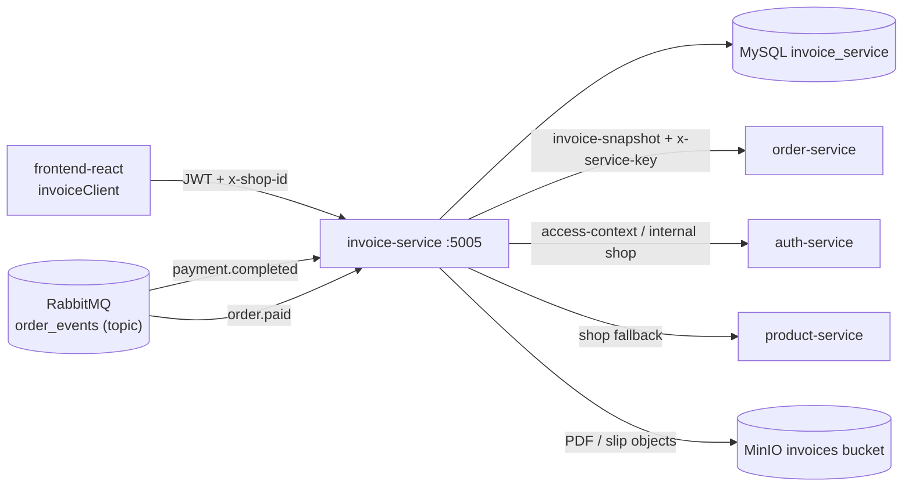
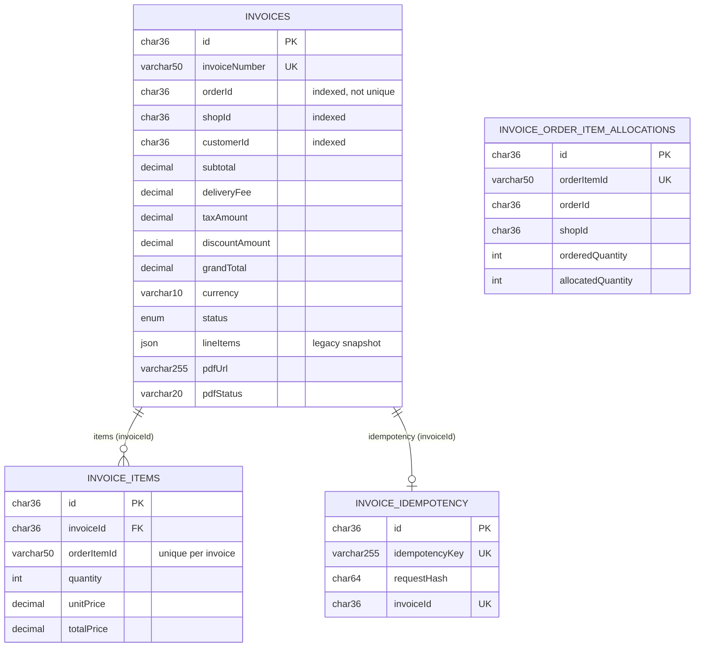
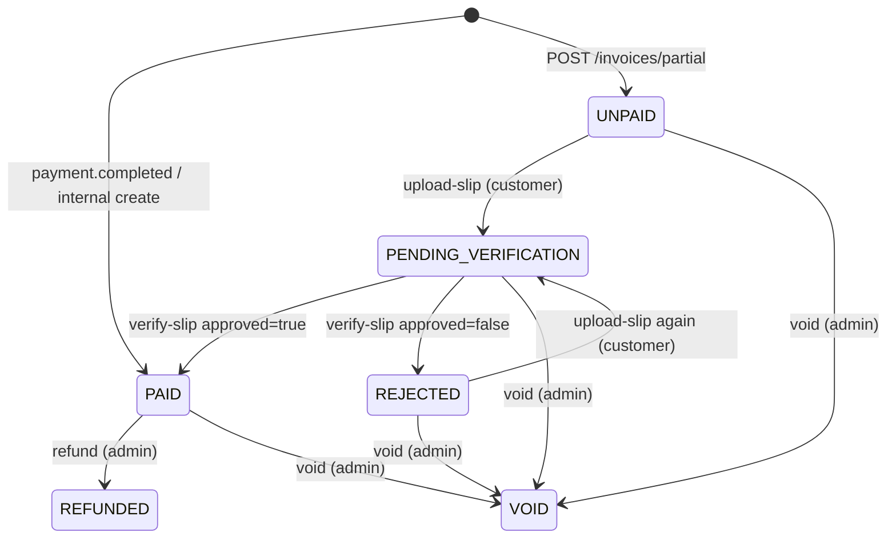
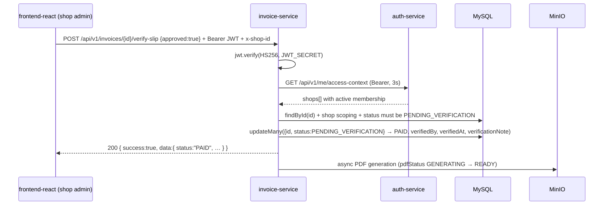
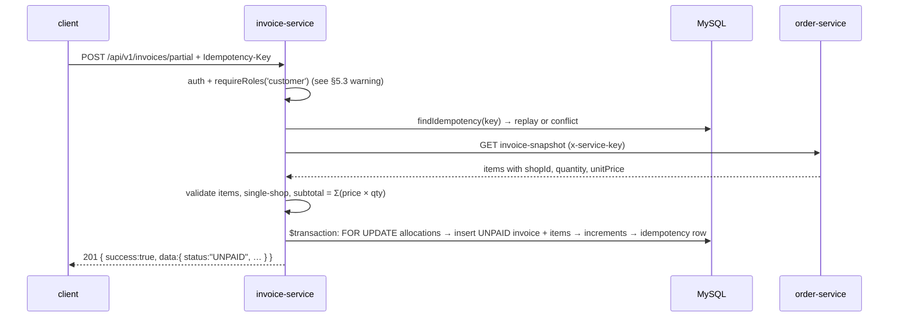
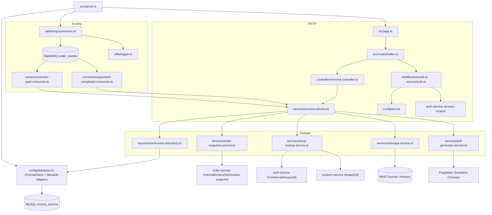

# Invoice Service

> Express + TypeScript microservice that owns invoices for the e-commerce platform: it turns paid orders
> (via RabbitMQ) into per-shop invoices, handles manual payment-slip verification, generates PDF invoices
> into MinIO object storage, and supports admin void/refund bookkeeping.

**Verified against the code in this repository** (`src/`, `prisma/`, `docker/`, `package.json`,
`docker-compose.yml`). Everything that could not be confirmed from the source is explicitly marked
`Not documented / not found in repository`.

---

## Table of contents

1. [Invoice Service Overview](#1-invoice-service-overview)
2. [Technology Stack](#2-technology-stack)
3. [Project Structure](#3-project-structure)
4. [Architecture](#4-architecture)
5. [Request Lifecycle](#5-request-lifecycle)
6. [API Endpoints](#6-api-endpoints)
7. [Authentication & Authorization](#7-authentication--authorization)
8. [Database Schema](#8-database-schema)
9. [Data Ownership](#9-data-ownership)
10. [RabbitMQ: Events Consumed and Published](#10-rabbitmq-events-consumed-and-published)
11. [Configuration / Environment Variables](#11-configuration--environment-variables)
12. [Invoice Lifecycle & Status Rules](#12-invoice-lifecycle--status-rules)
13. [Partial Invoicing & Item Allocation](#13-partial-invoicing--item-allocation)
14. [Idempotency](#14-idempotency)
15. [PDF Generation & Object Storage](#15-pdf-generation--object-storage)
16. [External Service Integrations](#16-external-service-integrations)
17. [Sequence Diagrams](#17-sequence-diagrams)
18. [Dependency Diagram](#18-dependency-diagram)
19. [Important Business Rules](#19-important-business-rules)
20. [Error Scenarios](#20-error-scenarios)
21. [Logging & Debugging](#21-logging--debugging)
22. [Testing](#22-testing)
23. [Common Development Tasks](#23-common-development-tasks)
24. [Production Deployment](#24-production-deployment)
25. [Security Considerations](#25-security-considerations)
26. [Developer Quick Start (5 minutes)](#26-developer-quick-start-5-minutes)
27. [Verified Gaps & Documentation Drift](#27-verified-gaps--documentation-drift)

---

## 1. Invoice Service Overview

### What it is responsible for

A REST + event-driven service (port **5005**) that owns the **invoice** domain of the platform:

| Responsibility | Where it lives in the code |
| --- | --- |
| Creating invoices from `payment.completed` events, one invoice per shop in the order | `src/rabbitmq/consumers/payment-completed.consumer.ts` → `InvoiceService.createInvoiceFromPayment` |
| Creating customer-initiated **partial (UNPAID)** invoices for selected order items | `POST /api/v1/invoices/partial` → `InvoiceService.createPartialInvoice` |
| Manual payment-slip upload and admin/shop verification | `uploadPaymentSlip`, `verifyInvoice` |
| Invoice numbering (`INV-YYYYMMDD-NNNNN`) | `InvoiceService.generateInvoiceNumber` |
| Invoice reads for customer / shop / admin, with shop-name enrichment | `listInvoices`, `populateMissingInvoiceShopNames` |
| Void and refund **bookkeeping** (status + reason + amount only) | `voidInvoice`, `refundInvoice` |
| PDF generation (Puppeteer → MinIO) with a persisted PDF lifecycle | `pdf-generator.service.ts`, `storage.service.ts`, `claimPdfGeneration` |
| Per-order-item allocation ledger so the same item cannot be invoiced twice | `invoice_order_item_allocations` + `invoice_idempotency` tables |
| Enriching invoice snapshots from `order.paid` (shop/customer display data) | `order-paid.consumer.ts` → `updateOrderSnapshot` |

### Role in the wider microservices architecture

```text
payment-service ──payment.completed──▶ RabbitMQ (order_events) ──▶ invoice-service
order-service   ──order.paid────────▶ RabbitMQ (order_events) ──▶ invoice-service
                                                                       │
                              HTTP (internal) ◀── order-snapshot ───────┤
                              (ORDER_SERVICE_URL + x-service-key)        │
                                                                         │
auth-service (Laravel)  ◀── JWT verify / access-context / internal shop ─┤
product-service         ◀── shop name fallback lookup ───────────────────┤
MinIO                   ◀── invoice PDFs + payment slips ────────────────┘
frontend-react          ──▶ invoice-service (VITE_INVOICE_SERVICE_URL, default http://localhost:5005/api/v1)
```

Cross-service facts verified in the neighbouring repositories:

* `payment-service` publishes `payment.completed` to exchange `order_events`
  (`payment-service/src/rabbitmq/publishers/payment.publisher.ts`, `RABBITMQ_EXCHANGE=order_events`).
* `order-service` (Laravel) publishes `order.paid` (`src/app/Enums/EventTopic.php:22`) and exposes
  `GET /api/internal/orders/{orderId}/invoice-snapshot`
  (`order-service/src/routes/api.php:20`, `InvoiceSnapshotController`) — the endpoint this service
  calls through `ORDER_SERVICE_URL`.
* `auth-service` (Laravel) exposes `GET /api/v1/me/access-context` (`src/routes/api.php:72`) and
  `GET /api/v1/internal/shops/{shopId}` behind the `X-Internal-Service-Key` header
  (`ValidateInternalServiceKey`).
* `frontend-react` calls this service through `frontend-react/src/lib/api/invoiceClient.ts`.

### What this service owns

* The `invoice_service` MySQL database: `invoices`, `invoice_items`,
  `invoice_order_item_allocations`, `invoice_idempotency`.
* Invoice status transitions, invoice numbering, verification/void/refund state changes.
* PDF lifecycle state (`pdfStatus`, `pdfError`, `pdfAttemptCount`, `pdfUpdatedAt`) and the generated
  invoice PDF / payment-slip objects in the MinIO `invoices` bucket.
* The RabbitMQ queues `invoice.payment.completed` and `invoice.order.paid`.

### What this service does NOT own

* Orders, checkout sessions, order totals and delivery addresses → **order-service** (this service only
  calls it for an invoice snapshot).
* Payment records, transactions and gateway refunds → **payment-service**. `refundInvoice()` only writes
  `REFUNDED` + `refundAmount`/`refundMethod`/`refundReason` locally; **no call to any payment provider
  exists in this repository**.
* Identity, users, shops, roles and shop memberships → **auth-service**.
* Product catalogue / SKU data → **product-service** (used only as a shop-name fallback lookup).
* Notification / e-mail delivery of invoices → `Not documented / not found in repository` (no mailer or
  notification-client dependency exists in `package.json`).

### Main technologies used

Express 4 (HTTP), TypeScript 5, Prisma 7 with the MariaDB driver adapter, MySQL 8, RabbitMQ
(`amqplib`), MinIO (`minio` client, S3-compatible), Puppeteer (HTML → PDF), `archiver` (ZIP batch
download), `jsonwebtoken` (HS256 verification), `zod` (environment validation), `winston` + `morgan`
(logging).

---

## 2. Technology Stack

Everything below is declared in `package.json`, used by `src/`, or defined in `docker-compose.yml`.

| Technology | Version (declared) | Purpose |
| --- | --- | --- |
| Node.js | 22 (Docker base `node:22-bookworm-slim`) | Runtime |
| TypeScript | ^5.3.3 | Language (`tsconfig.json`, strict mode, path aliases `@/*` → `src/*`) |
| Express | ^4.18.2 | HTTP framework (`src/app.ts`, `src/routes/index.ts`) |
| Prisma Client | ^7.0.0 | ORM / data access (`prisma/schema.prisma`, `src/config/database.ts`) |
| `@prisma/adapter-mariadb` | ^7.10.0 | Driver adapter used to connect Prisma to MySQL |
| `mariadb` | ^3.5.4 | Underlying MySQL/MariaDB driver for the adapter |
| MySQL | `mysql:8.0` (Docker) | Database (`invoice_service` schema) |
| RabbitMQ | `rabbitmq:3.13-management` (Docker) | Event consumption (`amqplib` ^0.10.4) |
| MinIO | `bitnamilegacy/minio:2025.7.23-debian-12-r5` (Docker) | S3-compatible storage for PDFs and payment slips (`minio` ^8.0.1 client). MinIO's own registries no longer serve the community server anonymously — see §11 |
| Puppeteer | ^24.0.0 | Renders invoice HTML to PDF (`pdf-generator.service.ts`) |
| `archiver` | ^7.0.1 | Streams the batch PDF download as a ZIP |
| `jsonwebtoken` | ^9.0.3 | Verifies HS256 bearer tokens (`middleware/auth.ts`) |
| `zod` | ^3.23.0 | Environment schema validation (`config/env.ts`) — not used for request validation |
| `winston` | ^3.11.0 | Application logger (`utils/logger.ts`) |
| `morgan` | ^1.10.0 | HTTP request logging (`app.ts`) |
| `cors` | ^2.8.5 | CORS with `credentials: true`, single configured origin |
| `helmet` | ^7.1.0 | Default HTTP security headers |
| `dotenv` | ^16.3.1 | Loads `.env` (`config/env.ts`, `prisma.config.ts`) |
| `tsx` | ^4.7.0 (dev) | Dev server / TS script runner (`npm run dev`) |
| `tsc-alias` | ^1.9.5 (dev) | Rewrites `@/*` aliases in the compiled output (`npm run build`) |
| Docker / Docker Compose | `docker/node/Dockerfile`, `docker-compose.yml` | Containerization of the service + MySQL + RabbitMQ + MinIO |
| Prisma CLI | ^7.0.0 (dev) | Migrations and client generation (`prisma.config.ts`) |

Not present (checked against `package.json`): no test-runner dependency, no ESLint/Prettier config file,
no rate limiter, no request-validation middleware (`joi`/`express-validator`/…), no OpenAPI tooling and no
HTTP client library — the service uses the global `fetch`.

---

## 3. Project Structure

```text
invoice-service/
├── docker/
│   └── node/
│       ├── Dockerfile              # Node 22 image, Chromium deps, Chrome install, prisma generate
│       └── docker-entrypoint.sh    # waits for MySQL, optionally runs `prisma migrate deploy`
├── docs/
│   ├── PAYLOAD_REFERENCE.md        # payload examples (contains stale entries — see §27)
│   └── SEED_PAYMENT_COMPLETED.md   # how to publish a test payment.completed event
├── prisma/
│   ├── migrations/                 # 11 applied migrations (init → PDF lifecycle)
│   └── schema.prisma               # Invoice, InvoiceItem, InvoiceOrderItemAllocation, InvoiceIdempotency
├── src/
│   ├── config/
│   │   ├── database.ts             # PrismaClient + PrismaMariaDb adapter, query logging in development
│   │   ├── env.ts                  # zod-validated environment (fails fast, exits with code 1)
│   │   └── s3.ts                   # MinIO client + bucket/publicBaseUrl config
│   ├── controllers/
│   │   └── invoice.controller.ts   # HTTP layer: parsing, guard clauses, res.status(...).json(...)
│   ├── middleware/
│   │   ├── auth.ts                 # JWT verification + Auth Service access-context; requireRoles()
│   │   ├── serviceAuth.ts          # `x-service-key` check for the internal create endpoint
│   │   └── errorHandler.ts         # maps AppError.statusCode → HTTP status, logs the failure
│   ├── rabbitmq/
│   │   ├── config.ts               # exchange/type/routing keys from env
│   │   ├── connection.ts           # single channel, 15 × 2s connection retry, no auto-reconnect
│   │   └── consumers/
│   │       ├── payment-completed.consumer.ts  # queue invoice.payment.completed
│   │       └── order-paid.consumer.ts         # queue invoice.order.paid
│   ├── repositories/
│   │   └── invoice.repository.ts   # all Prisma access, transactions, row locks, idempotency rows
│   ├── routes/
│   │   └── index.ts                # route table mounted at /api/v1
│   ├── scripts/
│   │   └── seed-payment-completed.ts  # publishes one test event (ConfirmChannel)
│   ├── services/
│   │   ├── invoice.service.ts      # business logic, money math, status transitions, PDF orchestration
│   │   ├── order-snapshot.service.ts  # HTTP client for order-service invoice-snapshot
│   │   ├── pdf-generator.service.ts   # Puppeteer HTML template → PDF buffer
│   │   ├── shop-lookup.service.ts     # shop name resolution (auth-service → product-service fallback)
│   │   └── storage.service.ts         # MinIO upload/download, bucket policy, 5 MB image limit
│   ├── types/
│   │   ├── express.d.ts            # Express.Request.user augmentation
│   │   └── invoice.ts              # domain types and event payload types
│   ├── utils/
│   │   └── logger.ts               # winston console logger
│   ├── app.ts                      # express app: helmet, cors, body parsers, routes, 404, errorHandler
│   └── server.ts                   # bootstrap: DB connect → RabbitMQ → consumers → listen → shutdown
├── .env / .env.example             # environment files (`.env` is git-ignored, see §11)
├── docker-compose.yml              # invoice-db, rabbitmq, minio, invoice-service + itv-network
├── package.json                    # scripts and dependencies
├── prisma.config.ts                # Prisma 7 config: datasource URL from process.env
└── tsconfig.json                   # ES2020 / Node16, strict, `@/*` aliases, outDir `dist`
```

Missing layers this service does *not* have: no dedicated request-validation middleware, no
`src/utils/` helpers other than the logger, and no `.github/`, `.gitlab-ci.yml`, `Dockerfile.prod`,
`docker-compose.prod.yml`, Kubernetes or Terraform files anywhere in this repository.

---

## 4. Architecture

### Layered flow (only components that actually exist)

```text
Client (frontend-react / service-to-service caller)
  ↓  HTTP  /api/v1/*
Express app (src/app.ts)  ── helmet → cors → json/urlencoded parsers → morgan → routes
  ↓
Route (src/routes/index.ts)  ── inline /health, otherwise invoiceController.* (bound)
  ↓
Middleware (auth.ts, serviceAuth.ts)  → populates req.user / rejects
  ↓
Controller (InvoiceController)  → parses body/params/headers, guard clauses, calls the service
  ↓
Service (InvoiceService)  → business rules, money math, orchestration, status transitions
  ↓
Repository (InvoiceRepository)  → Prisma Client only (transactions, row locks, idempotency rows)
  ↓
Database (MySQL via @prisma/adapter-mariadb)
```

Side channels from the service layer (not in the HTTP path):

```text
InvoiceService → OrderSnapshotService  → HTTP GET order-service /api/internal/orders/{id}/invoice-snapshot
InvoiceService → ShopLookupService     → HTTP auth-service /api/v1/internal/shops/{id} (then product-service /shops/{id})
InvoiceService → PdfGeneratorService   → Puppeteer → StorageService → MinIO
Error handler: Express errorHandler ← AppError subclasses (Validation/Unauthorized/Forbidden/NotFound/Conflict)
```

### Mermaid overview



### Layer responsibilities

| Layer | Files | Responsibility (verified) |
| --- | --- | --- |
| Routes | `src/routes/index.ts` | Declares every path, middleware chain and controller binding under `/api/v1`; inline `/health` handler. |
| Controllers | `src/controllers/invoice.controller.ts` | Reads `req.body`/`req.params`/`req.query`/headers, validates shape, enforces "shop context required", delegates to `invoiceService`, chooses 200/201/400/404, forwards errors with `next(error)`. Never touches Prisma. |
| Middleware | `src/middleware/*.ts` | `auth` verifies the bearer JWT (HS256) and resolves the effective role/shop; `requireRoles` gate-keeps by `req.user.role`; `serviceAuth` checks the `x-service-key` header; `errorHandler` maps `AppError.statusCode` (default 500) and logs. |
| Services | `src/services/invoice.service.ts` (+ 4 helpers) | Business rules: money validation in minor units, amount/currency equality with the order snapshot, per-shop allocation, invoice display-name precedence, status transitions, idempotency hashing, PDF orchestration. |
| Repositories | `src/repositories/invoice.repository.ts` | The only place Prisma is used: CRUD, `$transaction`, `SELECT … FOR UPDATE` row locks, idempotency insert, PDF claim/ready/failed updates. Returns raw Prisma models (Decimal objects). |
| Config | `src/config/{env,database,s3}.ts` | zod env schema (exits process on invalid env), Prisma client + MariaDB adapter, MinIO client/bucket config. |
| RabbitMQ layer | `src/rabbitmq/*` | Exchange declaration, single channel with bounded retry, two consumers bound to durable queues; each message is `ack`ed on success and `nack`ed **without requeue** on failure. |
| Prisma/DB layer | `prisma/schema.prisma`, `prisma/migrations/*` | 4 models, 1 enum, 11 migrations; JSON snapshot column (`lineItems`) kept alongside normalized `invoice_items`. |
| Utilities | `src/utils/logger.ts` | winston console logger used by almost every layer. |
| Types | `src/types/*` | `InvoiceStatus`, payload/event interfaces (`PaymentCompletedEvent`, `PartialInvoiceRequest`, …), Express `Request.user` augmentation. |

### Where RabbitMQ sits in the architecture

RabbitMQ is **inbound only** for business events: the service never publishes application events (no
publisher exists in `src/`). It asserts the durable topic exchange `RABBITMQ_EXCHANGE` (default
`order_events`) and consumes two durable queues:

| Queue | Routing key | Consumer |
| --- | --- | --- |
| `invoice.payment.completed` | `RABBITMQ_PAYMENT_COMPLETED_KEY` (default `payment.completed`) | Creates PAID invoice(s) from the order snapshot |
| `invoice.order.paid` | `order.paid` (hard-coded) | Updates shop/customer snapshot columns on the newest invoice of the order |

Publishers (`payment-service`, `order-service`) must send to the same exchange and routing keys. Event
delivery is asynchronous relative to the HTTP API; the only HTTP entry point that creates invoices without
RabbitMQ is the internal endpoint described in §6.

### Startup / shutdown sequence (`src/server.ts`)

1. `prisma.$connect()` — log `Database connected`; failure → `Failed to start Invoice Service` + `process.exit(1)`.
2. `getRabbitChannel()` — connect (up to 15 attempts, 2 s apart); then `startPaymentCompletedConsumer()` and
   `startOrderPaidConsumer()`; log `RabbitMQ consumer initialized`. Failure here also aborts startup.
3. `app.listen(env.PORT)` — log `Invoice service running on port ${PORT}`.
4. `SIGINT`/`SIGTERM` → `server.close()` → `prisma.$disconnect()` → `closeRabbitConnection()` → exit 0.

---

## 5. Request Lifecycle

All HTTP paths are prefixed with `/api/v1` (`app.use('/api/v1', routes)` in `src/app.ts`).

### 5.1 `GET /api/v1/invoices/shop-invoices`

```text
HTTP GET /api/v1/invoices/shop-invoices   (Authorization: Bearer <jwt>, x-shop-id: <shop>)
→ Route: router.get('/invoices/shop-invoices', auth, requireRoles('seller','shopAdmin','admin'),
                    invoiceController.getShopInvoices)
→ Middleware auth(): jwt.verify(token, env.JWT_SECRET, { algorithms:['HS256'] })
   • platform admin claim → req.user = { id: sub, customerId: sub, role:'admin', shopId: x-shop-id }
   • otherwise GET {AUTH_SERVICE_URL}/api/v1/me/access-context (3 s timeout)
       – shopId = x-shop-id header || context.active_shop.shop_id
       – an active membership must exist → req.user.role = 'shopAdmin', req.user.shopId
→ Middleware requireRoles(): role must be one of seller|shopAdmin|admin
→ Controller getShopInvoices(): requires req.user.shopId else 400 "Shop context is required"
→ Service getInvoicesByShop(shopId) → invoiceRepository.listInvoices({ shopId })
→ Prisma: invoice.findMany({ where:{ shopId }, select:{ …, items:{…} }, orderBy:{ createdAt:'desc' }, skip:0, take:50 })
→ Repository maps normalized `items` into `lineItems` when the legacy JSON column is empty
→ 200 { success: true, data: [ …at most 50 invoices… ] }
```

Note: `listInvoices` defaults to `skip = 0, take = 50`; the controller exposes **no** pagination
parameters (only `status` is read on `/invoices/manage` and `/invoices/admin/all`). An admin calling this
route without an `x-shop-id` header gets `400 Shop context is required`.

### 5.2 `POST /api/v1/invoices/:id/verify-slip`

```text
HTTP POST /api/v1/invoices/<uuid>/verify-slip   body { "approved": true, "reason": "slip matches" }
→ Route: auth, requireRoles('admin','shopAdmin','seller') → invoiceController.verifyInvoice
→ auth(): as above (role admin, or shopAdmin with an active membership in x-shop-id / active_shop)
→ Controller: approved must be a boolean (else 400); role admin OR req.user.shopId required (else 400)
→ Service verifyInvoice(id, approved, verifiedBy = req.user.id ?? 'system', reason, shopId)
   1. invoiceRepository.findById(id) → 404 NotFoundError when missing
   2. shop scoping: shopId && invoice.shopId !== shopId → 403 ForbiddenError
   3. status must be PENDING_VERIFICATION → 409 ConflictError otherwise
   4. invoiceRepository.transitionVerification(id, approved, verifiedBy, reason)
        = invoice.updateMany({ where:{ id, status:'PENDING_VERIFICATION' },
                               data:{ status: 'PAID' | 'REJECTED', … } })
        count !== 1 → 409 ConflictError "Invoice has already been verified"
        approved → verificationNote = reason            ; REJECTED → rejectionReason = reason ?? 'Payment verification rejected'
   5. if approved → void generatePdfAsync(id, invoice)   (fire-and-forget; does not block the response)
→ 200 { success: true, data: <updated invoice> }
```

### 5.3 `POST /api/v1/invoices/partial` (customer)

```text
HTTP POST /api/v1/invoices/partial   headers: Authorization, Idempotency-Key
  body { "orderId":"…", "items":[{"orderItemId":"…","quantity":2}],
         "customerName":"…", "customerEmail":"…", "paymentMethod":"MANUAL_SLIP" }
→ Route: auth, requireRoles('customer') → invoiceController.createPartialInvoice
→ Controller: customerId = req.user.customerId (else 400); idempotencyKey = req.headers['Idempotency-Key'] ?? ''
→ Service createPartialInvoice(payload, customerId, idempotencyKey)
   1. missing/blank Idempotency-Key → ValidationError 400
   2. normalizePartialInvoiceRequest(): trim, lowercase email, uppercase paymentMethod (default MANUAL_SLIP), sort items
   3. validatePartialInvoiceRequest(): orderId required, ≥1 item, no duplicate orderItemId, positive integer quantity
   4. sha256 request hash via buildPartialInvoiceRequestHash()
   5. invoiceRepository.findIdempotency(key) → same hash ⇒ return the stored invoice (replay)
                                              → different hash ⇒ ConflictError 409
   6. orderSnapshotService.getInvoiceSnapshot(orderId) → order-service HTTP call (see §16)
   7. validate every snapshot item (ids, productName, shopId, integer quantity, `^\d+(\.\d{1,2})?$` unit price)
   8. map requested items onto snapshot items; quantity ≤ ordered quantity; all items must belong to one shop
   9. subtotal = Σ(unitPrice × requestedQuantity) (2 dp); taxAmount = 0.00; discountAmount = 0.00; grandTotal = subtotal
  10. invoiceRepository.createPartialInvoice(...) → single transaction (see §13 and §14)
→ 201 { success: true, data: <invoice with items> }
```

⚠️ **Verified limitation:** `auth()` only assigns the `customer` role when the request path contains
`/invoices/my-invoices` (`src/middleware/auth.ts:102-115`). A request to `/invoices/partial` (or
`/invoices/:id/upload-slip`) therefore resolves to `admin` (platform admin claim), `shopAdmin` (active
shop membership) or is rejected, so `requireRoles('customer')` cannot pass in practice. See §27.

### 5.4 `payment.completed` → PAID invoice (asynchronous)

```text
RabbitMQ order_events / payment.completed
→ queue invoice.payment.completed → payment-completed.consumer.ts
→ payload guard: event === 'payment.completed', version === 'v1', payment_id, order_id, transaction_id,
   checkout_id, numeric finite amount, currency → invalid ⇒ throw ⇒ nack(requeue = false)
→ invoiceService.createInvoiceFromPayment({ paymentId, orderId, transactionId, amount, currency,
                                            paymentMethod, shopName, customerName, customerEmail })
   1. orderSnapshotService.getInvoiceSnapshot(orderId)
   2. amount must equal snapshot.grandTotal (minor-unit comparison) → else ValidationError (message dropped)
   3. snapshot currency (when present) must equal the payment currency
   4. group snapshot items by shopId → one invoice per shop
   5. resolveInvoiceShopNames() → auth-service internal lookup, product-service fallback (§16)
   6. allocateShopTotals() → pro-rata delivery fee + discount per shop, remainder on the last shop
   7. per shop idempotency key: `payment:<paymentId>` (single shop) or `payment:<paymentId>:shop:<shopId>`
   8. invoiceRepository.createPaidInvoiceFromPayment() → transaction + FOR UPDATE locks + allocation increments
   9. void generatePdfAsync(invoice.id, invoice)   (fire-and-forget per invoice)
→ channel.ack(message)   |   on any error: logger.error(...) + channel.nack(message, false, false)
```

### 5.5 `POST /api/v1/invoices/batch/download`

```text
HTTP POST /api/v1/invoices/batch/download   body { "invoiceIds": ["…","…"] }
→ auth + requireRoles('admin','shopAdmin','seller') → invoiceController.downloadBatchPdf
→ Controller: invoiceIds must be a non-empty array of non-blank strings (else 400);
              role admin OR req.user.shopId required (else 400)
→ Service buildBatchPdfArchive(ids, shopId): per id → findById (missing ids are skipped) → shop check (403
   when the invoice belongs to another shop) → reuse pdfUrl or generate it on the fly (403 case included)
   → storageService.downloadPdf(pdfUrl) → Buffer
→ Controller streams a ZIP: archiver('zip', { zlib:{ level:9 } }) with
     Content-Type: application/zip
     Content-Disposition: attachment; filename="invoice-batch-<Date.now()>.zip"
   empty entry list → 400 "No downloadable PDFs were found for the selected invoices."
→ 200 (binary ZIP stream)
```

### 5.6 `POST /api/v1/internal/invoices/create` (service-to-service)

```text
HTTP POST /api/v1/internal/invoices/create   header x-service-key: <SERVICE_API_KEY>
     body { "paymentId","orderId","transactionId","amount":105000.00,"currency":"MMK",
            "paymentMethod":"MANUAL_SLIP","shopName":"…","customerName":"…","customerEmail":"…" }
→ Middleware serviceAuth(): header must exist and equal env.SERVICE_API_KEY, else 401
→ Controller createInvoice(): shopName, customerName and customerEmail must be non-blank → else 400
→ Service createInvoiceFromPayment(...)  (identical business path to §5.4, including the async PDF)
→ 201 { success: true, data: <invoice> | [<invoice per shop>] }
```

This is the only HTTP entry point that creates invoices; the RabbitMQ consumer calls the same service
method directly (without the controller's `shopName`/`customerName`/`customerEmail` presence check).

---

## 6. API Endpoints

All routes are registered in `src/routes/index.ts` and mounted at `/api/v1` (`src/app.ts`). `auth` means
the JWT middleware from §7; `serviceAuth` means the `x-service-key` header check.

| Method | Endpoint | Middleware | Controller | Purpose | Authentication |
| --- | --- | --- | --- | --- | --- |
| GET | `/api/v1/health` | – | inline handler | Liveness probe → `{ success, message, timestamp }` | None |
| GET | `/api/v1/invoices/my-invoices` | `auth`, `requireRoles('customer')` | `getMyInvoices` | Invoices of the authenticated customer | Bearer JWT (customer) |
| GET | `/api/v1/invoices/shop-invoices` | `auth`, `requireRoles('seller','shopAdmin','admin')` | `getShopInvoices` | Invoices of the active shop | Bearer JWT (seller/shopAdmin/admin) |
| GET | `/api/v1/invoices/manage` | `auth`, `requireRoles('shopAdmin','admin')` | `getManageInvoices` | Shop invoices, optional `?status=` | Bearer JWT (shopAdmin/admin) |
| GET | `/api/v1/invoices/admin/all` | `auth`, `requireRoles('admin')` | `getAdminInvoices` | All invoices, optional `?status=` (shop names enriched) | Bearer JWT (admin) |
| POST | `/api/v1/invoices/:id/verify-slip` | `auth`, `requireRoles('admin','shopAdmin','seller')` | `verifyInvoice` | Approve/reject a manual payment slip | Bearer JWT (admin/shopAdmin/seller) |
| POST | `/api/v1/invoices/:id/upload-slip` | `auth`, `requireRoles('customer')` | `uploadPaymentSlip` | Customer uploads a slip image (data URL) → `PENDING_VERIFICATION` | Bearer JWT (customer) |
| POST | `/api/v1/invoices/:id/void` | `auth`, `requireRoles('admin')` | `voidInvoice` | Void an invoice with a reason (≥ 10 chars) | Bearer JWT (admin) |
| POST | `/api/v1/invoices/:id/refund` | `auth`, `requireRoles('admin')` | `refundInvoice` | Mark an invoice refunded (amount/method/reason) | Bearer JWT (admin) |
| POST | `/api/v1/invoices/batch/generate-pdf` | `auth`, `requireRoles('admin','shopAdmin','seller')` | `generateBatchPdf` | Generate PDFs for up to N invoices | Bearer JWT (admin/shopAdmin/seller) |
| POST | `/api/v1/invoices/batch/download` | `auth`, `requireRoles('admin','shopAdmin','seller')` | `downloadBatchPdf` | Download the selected PDFs as a ZIP | Bearer JWT (admin/shopAdmin/seller) |
| POST | `/api/v1/invoices/:id/generate-pdf` | `auth`, `requireRoles('admin','shopAdmin','seller')` | `generatePdf` | Generate/refresh one invoice PDF | Bearer JWT (admin/shopAdmin/seller) |
| POST | `/api/v1/invoices/partial` | `auth`, `requireRoles('customer')` | `createPartialInvoice` | Create an UNPAID partial invoice (`Idempotency-Key` required) | Bearer JWT (customer) |
| POST | `/api/v1/internal/invoices/create` | `serviceAuth` | `createInvoice` | Service-to-service invoice creation (PAID) | `x-service-key` header |

Unregistered but referenced in `src/app.ts`:

| Path | Behaviour |
| --- | --- |
| `/api/v1/webhooks/payment` | The JSON and urlencoded parsers are **skipped** for this exact `originalUrl`, but no route handles it — requests fall through to the app-level 404 handler `Route not found: …`. It looks like a reserved raw-body webhook path. |

Any other unmatched path → `app.use((req,res) => …)` in `src/app.ts`:
`404 { success: false, message: "Route not found: <METHOD> <url>" }`.

### Request / response examples (from the actual handlers and Prisma schema)

`POST /api/v1/invoices/partial` → `201`

```json
{
  "success": true,
  "data": {
    "id": "…uuid…",
    "invoiceNumber": "INV-20260930-48213",
    "orderId": "…uuid…",
    "shopId": "…uuid…",
    "customerId": "…uuid…",
    "customerName": "Jane Doe",
    "customerEmail": "jane@example.com",
    "subtotal": "50000.00",
    "deliveryFee": "0",
    "taxAmount": "0.00",
    "discountAmount": "0.00",
    "grandTotal": "50000.00",
    "currency": "MMK",
    "paymentMethod": "MANUAL_SLIP",
    "status": "UNPAID",
    "pdfStatus": "PENDING",
    "pdfAttemptCount": 0,
    "items": [ { "orderItemId": "…", "productId": "…", "productName": "…", "quantity": 2, "unitPrice": "25000.00", "totalPrice": "50000.00" } ]
  }
}
```

`POST /api/v1/invoices/:id/upload-slip` → `200` (body carries the MinIO URL and the new status)

```json
{ "success": true, "data": { "id": "…", "status": "PENDING_VERIFICATION", "paymentSlipUrl": "http://localhost:9000/invoices/payment-slips/<invoiceId>.png" } }
```

`POST /api/v1/invoices/:id/refund` → `200`

```json
{ "success": true, "data": { "id": "…", "status": "REFUNDED", "refundAmount": "25000.00", "refundMethod": "BANK_TRANSFER", "refundReason": "Customer returned the item" } }
```

Error envelope (all handlers and the error middleware):

```json
{ "success": false, "message": "Invoice not found" }
```

`GET /api/v1/health` → `200 { "success": true, "message": "Invoice Service is running", "timestamp": "2026-09-30T…Z" }`

### List query notes

* `GET /invoices/manage?status=<status>` and `GET /invoices/admin/all?status=<status>`: the value is
  uppercased and must be one of `UNPAID, PENDING_VERIFICATION, PAID, REJECTED, VOID, REFUNDED`;
  anything else throws a plain `Error` → **500** (not 400) via the error middleware.
* `GET /invoices/shop-invoices` ignores any `?status=` query parameter even though the frontend client
  sends one (`frontend-react/src/lib/api/invoiceClient.ts` passes `params: { status }`).

---

## 7. Authentication & Authorization

### `auth` middleware (`src/middleware/auth.ts`)

| Step | Behaviour |
| --- | --- |
| Header | Requires `Authorization: Bearer <token>`; missing/invalid → `401 Authentication required` |
| Config | If `env.JWT_SECRET` is not set → `503 Invoice authentication is not configured` |
| Verification | `jwt.verify(token, env.JWT_SECRET, { algorithms: ['HS256'] })`; `TokenExpiredError` → `401 Token expired`, otherwise → `401 Invalid authentication token` |
| Subject | `claims.sub` must be a non-empty string → else `401 Authenticated user ID is missing` |
| Platform admin | `claims.role` normalised (lowercase, `-`/space → `_`) and matched against `admin, super_admin, platform_super_admin, superadmin` → `req.user.role = 'admin'` (no Auth Service call) |
| Customer | Path contains `/invoices/my-invoices` → `req.user.role = 'customer'`, no shop |
| Shop user | Otherwise calls `GET {AUTH_SERVICE_URL}/api/v1/me/access-context` with `Authorization: Bearer <token>` and a **3-second timeout**; the response may be `{ data: { access_context: … } }` or the legacy `{ data: { shops: [...] } }` (`parseAccessContextResponse`). Shop = `x-shop-id` header or `context.active_shop.shop_id`; a matching entry in `context.shops` with `membership_status === 'active'` is required → else `403 User is not assigned to the requested shop`; otherwise `req.user.role = 'shopAdmin'`, `req.user.shopId = shopId` |

Resulting `req.user` shape (also declared in `src/types/express.d.ts`):

```ts
{ id: string; customerId: string; role: 'customer' | 'shopAdmin' | 'admin'; shopId?: string; token: string }
// id and customerId are both claims.sub
```

* `requireRoles(...roles)` passes only when `req.user.role` is in the list, otherwise
  `403 Forbidden: insufficient role permissions`.
* The role `'seller'` is accepted by several `requireRoles` calls but **is never assigned by `auth()`**
  (only `customer`, `shopAdmin`, `admin` are produced) → seller-only requests are impossible today.
* Headers such as `x-user-role`, `x-user-id`, `x-customer-id` (still sent by the frontend client) are
  **not read** by this middleware.

### `serviceAuth` middleware (`src/middleware/serviceAuth.ts`)

* Requires header `x-service-key` to equal `env.SERVICE_API_KEY` exactly (plain string comparison, not
  timing-safe); otherwise `401 Unauthorized service request`.
* Used only by `POST /api/v1/internal/invoices/create`.

### Authorization of invoice content

* Customer scope: `getMyInvoices` uses `req.user.customerId`; `uploadPaymentSlip` verifies
  `invoice.customerId === customerId` (mismatch → plain `Error` → 500, see §20).
* Shop scope: `verifyInvoice`, `generateInvoicePdf`, `generateInvoicePdfBatch` and `buildBatchPdfArchive`
  compare `invoice.shopId` with `req.user.shopId` and throw `ForbiddenError` (403) on mismatch.
  Listing routes scope the Prisma `where` clause by `shopId`/`customerId`.
* Invoice-scoped routes do not verify per-invoice ownership beyond the checks above (no ownership record
  is stored for admins/shop admins).

---

## 8. Database Schema

Datasource: `provider = "mysql"` (`prisma/schema.prisma`), URL taken from `DATABASE_URL` inside
`prisma.config.ts`; at runtime the Prisma Client is constructed with the `PrismaMariaDb` adapter
(`src/config/database.ts`). Ten migrations are applied in `prisma/migrations/`.

### `InvoiceStatus` enum

`UNPAID`, `PENDING_VERIFICATION`, `PAID`, `REJECTED`, `VOID`, `REFUNDED` (MySQL `ENUM`, default `UNPAID`).

### `invoices` (model `Invoice`)

| Column | Type | Notes |
| --- | --- | --- |
| `id` | `CHAR(36)` PK | `@default(uuid())` |
| `invoiceNumber` | `VARCHAR(50)` **unique** | `INV-YYYYMMDD-NNNNN` |
| `orderId` | `CHAR(36)` | Indexed; **no longer unique** since `20260918000400` (one order → many invoices) |
| `shopId` | `CHAR(36)` | Indexed (`shopId`, `shopId+status`, mapped `invoices_shopId_idx`) |
| `shopName` | `VARCHAR(255)` NULL | Added by `20260918000300` |
| `customerId` | `CHAR(36)` | Indexed |
| `customerName` | `VARCHAR(255)` NULL | Added by `20260918000100` |
| `customerEmail` | `VARCHAR(255)` NULL | Added by `20260918000100` |
| `lineItems` | `JSON` NULL | Legacy JSON snapshot; still written on the payment flow and used as a fallback when `invoice_items` is empty |
| `subtotal` | `DECIMAL(12,2)` | required |
| `deliveryFee` | `DECIMAL(12,2)` default `0` | Added by `20260920000100` |
| `taxAmount` | `DECIMAL(12,2)` default `0` | |
| `discountAmount` | `DECIMAL(12,2)` default `0` | |
| `grandTotal` | `DECIMAL(12,2)` | |
| `currency` | `VARCHAR(10)` default `MMK` | |
| `paymentMethod` | `VARCHAR(50)` NULL | Was `NOT NULL`; made nullable by `20260920000100` |
| `paymentGatewayRef` | `VARCHAR(255)` NULL | Set to the payment `transaction_id` on the event path |
| `paymentSlipUrl` | `VARCHAR(255)` NULL | Public MinIO URL |
| `status` | enum | default `UNPAID` |
| `pdfUrl` | `VARCHAR(255)` NULL | Public MinIO URL of the generated PDF |
| `pdfStatus` | `VARCHAR(20)` default `PENDING` | `PENDING → GENERATING → READY / FAILED` (`20260922000100`) |
| `pdfError` | `TEXT` NULL | Last failure message, truncated to 4000 characters |
| `pdfAttemptCount` | `INT` default `0` | Incremented on every claim |
| `pdfUpdatedAt` | `DATETIME(3)` NULL | Basis for the 15-minute stale-`GENERATING` takeover |
| `verifiedBy` | `CHAR(36)` NULL | JWT `sub`, or `'system'` when absent |
| `verifiedAt` | `DATETIME(3)` NULL | |
| `rejectionReason` | `TEXT` NULL | Slip rejection reason / void reason |
| `verificationNote` | `TEXT` NULL | Approval note (`20260918000200`) |
| `refundAmount` / `refundMethod` / `refundReason` | `DECIMAL(12,2)` / `VARCHAR(50)` / `TEXT`, all NULL | `20260916160000` |
| `createdAt` / `updatedAt` | `DATETIME(3)` | `updatedAt` managed by Prisma |

Relations: `items InvoiceItem[]`, `idempotency InvoiceIdempotency?`; mapped table `invoices`.

### `invoice_items` (model `InvoiceItem`)

| Column | Type | Notes |
| --- | --- | --- |
| `id` | `CHAR(36)` PK | |
| `invoiceId` | `CHAR(36)` FK | → `invoices.id`, `ON DELETE RESTRICT`, `ON UPDATE CASCADE` |
| `orderItemId` | `VARCHAR(50)` | Order-service reference — **not** a local foreign key; widened by `20260919034630` |
| `productId` | `CHAR(36)` | |
| `productName` / `productSku` | `VARCHAR(255)` / `VARCHAR(100)` NULL | |
| `quantity` | `INT` | |
| `unitPrice` | `DECIMAL(12,2)` | |
| `taxAmount` / `discountAmount` | `DECIMAL(12,2)` default `0` | Always written as `'0'` by the repository |
| `totalPrice` | `DECIMAL(12,2)` | |
| `createdAt` / `updatedAt` | `DATETIME(3)` | |

Unique `(invoiceId, orderItemId)`; indexes on `orderItemId` and `productId`; mapped table `invoice_items`.

### `invoice_order_item_allocations` (model `InvoiceOrderItemAllocation`)

The allocation ledger that prevents double invoicing of an order item:

| Column | Type | Notes |
| --- | --- | --- |
| `id` | `CHAR(36)` PK | |
| `orderItemId` | `VARCHAR(50)` **unique** | One ledger row per order item |
| `orderId` / `shopId` | `CHAR(36)` | Indexed, also `(orderId, shopId)` |
| `orderedQuantity` | `INT` | Snapshot of the ordered quantity |
| `allocatedQuantity` | `INT` default `0` | Incremented inside the invoice transaction |
| `productId` / `productName` / `productSku` | snapshot | |
| `unitPrice` / `currency` | snapshot | Re-validated under `FOR UPDATE` |
| `createdAt` / `updatedAt` | `DATETIME(3)` | |

### `invoice_idempotency` (model `InvoiceIdempotency`)

| Column | Type | Notes |
| --- | --- | --- |
| `id` | `CHAR(36)` PK | |
| `idempotencyKey` | `VARCHAR(255)` **unique** | `payment:<paymentId>[:shop:<shopId>]` or the client's `Idempotency-Key` |
| `requestHash` | `CHAR(64)` | sha256 hex of the canonical request |
| `invoiceId` | `CHAR(36)` **unique** FK | → `invoices.id`, one record per invoice |
| `createdAt` / `updatedAt` | `DATETIME(3)` | |

### Entity relationship diagram



(The `invoice_order_item_allocations` table has no relation to `invoices`; it is matched by
`orderItemId` at runtime.)

---

## 9. Data Ownership

| Data | Owner | This service's use |
| --- | --- | --- |
| Orders, checkout sessions, order items, delivery address, order totals | **order-service** | Read-only through `GET /api/internal/orders/{orderId}/invoice-snapshot` (`x-service-key`); snapshot values are copied into invoice columns. |
| Payments, transactions, gateways, refund execution | **payment-service** | Consumes `payment.completed`; stores `paymentGatewayRef = transaction_id`. Refunds are recorded locally only. |
| Users, shops, memberships, roles | **auth-service** | Verifies JWTs' access context and resolves shop names via `GET /api/v1/internal/shops/{shopId}`. |
| Products, SKUs, shop catalogue | **product-service** | Fallback read for a shop name (`GET {PRODUCT_SERVICE_URL}/shops/{shopId}`). Product names/SKUs are stored as snapshots in `invoice_items` and are not kept in sync. |
| Invoice objects (PDF, slips), invoice status, idempotency keys | **invoice-service** | Full ownership (this database + MinIO bucket). |
| Notification of customers about invoices | – | `Not documented / not found in repository`. |

---

## 10. RabbitMQ: Events Consumed and Published

Configuration (`src/rabbitmq/config.ts`, `src/rabbitmq/connection.ts`):

* URL `RABBITMQ_URL`; exchange `RABBITMQ_EXCHANGE` (default `order_events`), type **topic**, `durable: true`.
* A single connection/channel is created lazily; connection attempts are retried **15 times with a 2 s
  delay** and then throw (`RabbitMQ connection attempts exhausted`), which aborts startup.
* On `close`, the module nulls the cached channel/connection but **does not reconnect or re-register
  consumers** — a broker restart requires a service restart.
* Every message is `ack`ed on success and `nack(message, false, false)` (no requeue) on failure, so a
  failed event is discarded. No dead-letter exchange/queue is declared anywhere in the repository.

### Consumed: `payment.completed`

| Property | Value |
| --- | --- |
| Exchange / routing key | `RABBITMQ_EXCHANGE` / `RABBITMQ_PAYMENT_COMPLETED_KEY` (defaults `order_events` / `payment.completed`) |
| Queue | `invoice.payment.completed` (durable, bound in `startPaymentCompletedConsumer`) |
| Producer | `payment-service` (`payment-service/src/rabbitmq/publishers/payment.publisher.ts`) |
| Code | `src/rabbitmq/consumers/payment-completed.consumer.ts` |

Fields the consumer validates before doing anything else: `event === 'payment.completed'`,
`version === 'v1'`, `data.payment_id`, `data.order_id`, `data.transaction_id`, `data.checkout_id`
(all non-blank strings), `data.amount` (finite number) and `data.currency` (non-blank).
Anything missing ⇒ `Invalid payment.completed payload` ⇒ nack/discard.

Fields **used**: `payment_id`, `order_id`, `transaction_id`, `amount`, `currency`, `payment_method`,
`shop_name`, `customer_name`, `customer_email`.
Fields **ignored**: `event_id`, `timestamp`, `producer`, `correlation_id`, `reservation_id`,
`checkout_id`, `updatedAt` and everything else.

⚠️ `shop_name`, `customer_name` and `customer_email` are declared in the local type
(`src/types/invoice.ts`), but the `payment-service` envelope only carries `shop_id`, `seller_id` and
`shop_breakdown`; in practice these arrive as `undefined`/`null`, so the invoice falls back to the order
snapshot and the shop-name lookup.

### Consumed: `order.paid`

| Property | Value |
| --- | --- |
| Exchange / routing key | `RABBITMQ_EXCHANGE` / `order.paid` (hard-coded in the consumer) |
| Queue | `invoice.order.paid` (durable) |
| Producer | `order-service` (Laravel, `src/app/Enums/EventTopic.php`; documented payload in `order-service/src/docs/PAYLOAD_REFERENCE.md`) |
| Code | `src/rabbitmq/consumers/order-paid.consumer.ts` |

Behaviour: requires `data.order_id`; reads `data.line_items` (filtered to items with a string `name`,
numeric `quantity`, string `unitPrice` and string `total`) plus `data.deliveryAddress.full_name` /
`data.deliveryAddress.email`. If at least one of those is present it calls
`invoiceService.updateOrderSnapshot(...)`, which updates the **most recently created invoice of that
order**. Messages are acked whether or not anything matched.

⚠️ `updateOrderSnapshot` writes only `shopName`, `customerName` and `customerEmail`; the `lineItems`
argument is accepted by the signature but **never persisted**, and for multi-shop orders only the newest
invoice is touched.

### Published

`Not documented / not found in repository` — `src/` contains no publisher. The only publish path is the
manual seed script (`src/scripts/seed-payment-completed.ts`), which uses a `ConfirmChannel` to publish one
`payment.completed` event to the configured exchange/routing key for local testing.

---

## 11. Configuration / Environment Variables

All variables are validated by `zod` in `src/config/env.ts` at import time; invalid or missing values print
`❌ Invalid environment variables:` with the offending fields and call `process.exit(1)`.

| Variable | Required | Type / default | In `.env.example` | Used by |
| --- | --- | --- | --- | --- |
| `NODE_ENV` | no | `development` \| `production` \| `test`, default `development` | yes | server, Prisma query logging, morgan format |
| `PORT` | no | positive integer, default `5005` | yes | `server.ts` |
| `DATABASE_URL` | **yes** | non-empty string (also read directly by `config/database.ts` and `prisma.config.ts`) | yes | Prisma / MariaDB adapter |
| `CORS_ORIGIN` | no | string, default `http://localhost:5173` | yes | `app.ts` |
| `LOG_LEVEL` | no | `error` \| `warn` \| `info` \| `debug`, default `info` | yes | winston |
| `SERVICE_API_KEY` | **yes** | string, min 8 chars | yes | `serviceAuth` |
| `JWT_SECRET` | no | string, min 32 chars | **no** | `auth` — without it every protected route returns `503` |
| `AUTH_SERVICE_URL` | no | URL, default `http://authservice-nginx:80` | **no** | access-context + shop lookup |
| `AUTH_SERVICE_INTERNAL_KEY` | no | string, min 8 chars | **no** | `shop-lookup.service.ts` → `X-Internal-Service-Key` |
| `ORDER_SERVICE_URL` | **yes** | valid URL | yes (local value `http://host.docker.internal:8001`) | `order-snapshot.service.ts` |
| `ORDER_SERVICE_API_KEY` | **yes** | string, min 8 chars | yes (local placeholder) | `order-snapshot.service.ts` → `x-service-key` |
| `PRODUCT_SERVICE_URL` | no | valid URL | **no** | shop-name fallback lookup |
| `RABBITMQ_URL` | no | string, default `amqp://localhost:5672` | yes | `rabbitmq/connection.ts` |
| `RABBITMQ_EXCHANGE` | no | string, default `order_events` | yes | exchange declaration |
| `RABBITMQ_PAYMENT_COMPLETED_KEY` | no | string, default `payment.completed` | yes | consumer binding |
| `MINIO_ENDPOINT` | no | string, default `localhost` | yes | MinIO client |
| `MINIO_PORT` | no | positive integer, default `9000` (`9010` in `.env` for host-side runs; compose overrides the container to `9000`) | yes | MinIO client |
| `MINIO_ACCESS_KEY` | **yes** | non-empty string | yes | MinIO client |
| `MINIO_SECRET_KEY` | **yes** | non-empty string | yes | MinIO client |
| `MINIO_BUCKET` | no | string, default `invoices` | yes | bucket name |
| `MINIO_USE_SSL` | no | `'true'` → `true`, default `false` | yes | MinIO client |
| `PUBLIC_BASE_URL` | no | string, default `http://localhost:9000` | yes | public URL prefix for PDFs/slips |

Variables read outside the zod schema:

| Variable | Read by | Meaning |
| --- | --- | --- |
| `DATABASE_HOST`, `DATABASE_PORT` | `docker-entrypoint.sh` | Host/port polled until MySQL accepts TCP connections (fallback: parsed from `DATABASE_URL`) |
| `AUTO_MIGRATE` | `docker-entrypoint.sh` | When `true` (set by compose) `prisma migrate deploy` runs before the app starts |
| `SEED_EVENT_ID`, `SEED_PAYMENT_ID`, `SEED_ORDER_ID`, `SEED_TRANSACTION_ID`, `SEED_CHECKOUT_ID`, `SEED_AMOUNT`, `SEED_CURRENCY`, `SEED_SHOP_NAME`, `SEED_CUSTOMER_NAME`, `SEED_CUSTOMER_EMAIL`, `SEED_CORRELATION_ID` | `src/scripts/seed-payment-completed.ts` | Overrides for the seed event |
| `SHADOW_DATABASE_URL` | `prisma.config.ts` | Optional shadow database URL for the Prisma CLI |
| `PUPPETEER_SKIP_DOWNLOAD`, `PUPPETEER_CACHE_DIR` | `docker/node/Dockerfile` | Chrome download/cache behaviour |

The current `.env` in the repository defines: `NODE_ENV`, `PORT`, `DATABASE_URL`, `CORS_ORIGIN`,
`LOG_LEVEL`, `SERVICE_API_KEY`, `RABBITMQ_*` (3 variables), `MINIO_*` (6 variables), `PUBLIC_BASE_URL`,
`ORDER_SERVICE_URL` and `ORDER_SERVICE_API_KEY`.

### Local Docker execution notes

1. **Local Docker values are supplied in `.env`**: `ORDER_SERVICE_URL=http://host.docker.internal:8001`
   (the order-service dev stack publishes its nginx on `APP_PORT=8001`) and a local
   `ORDER_SERVICE_API_KEY` placeholder — both are required by the zod schema, so the container fails
   validation without them. `docker-compose.yml` already forwards them, and the service also declares
   `extra_hosts: host.docker.internal:host-gateway` so that URL resolves from inside the container
   (verified: `192.168.65.254`). Replace both with the real order-service URL/key outside local
   development; `ORDER_SERVICE_API_KEY` must equal order-service's `WALLET_SERVICE_API_KEY` for
   `/api/internal/orders/*` calls to be accepted.
2. **MinIO endpoint/port are per-environment**: `.env` keeps the host-side values
   (`MINIO_ENDPOINT=localhost`, `MINIO_PORT=9010` = the published host port, `PUBLIC_BASE_URL=
   http://localhost:9010` for browser-facing object URLs), while `docker-compose.yml` overrides
   `MINIO_ENDPOINT=minio` / `MINIO_PORT=9000` for the container.
3. **MinIO's own images are no longer anonymously pullable**, so `docker-compose.yml` pins
   `bitnamilegacy/minio:2025.7.23-debian-12-r5` (Broadcom's legacy archive: Apache-2.0 packaging of the
   AGPLv3 MinIO community server). Verified: `quay.io/minio/*` returns 401 for anonymous pulls (the issued
   anonymous token has an empty permission set, while other public Quay images still pull), `minio/minio`
   on Docker Hub no longer exists, `quay.io/minio/aistor/*` pulls but answers every S3 request with
   `AccessDenied: No license is installed`, and the official binaries/release assets are gone
   (`dl.min.io` → 410, GitHub assets → 404). The image runs the same `minio server` binary and the same
   `MINIO_ROOT_USER`/`MINIO_ROOT_PASSWORD` variables on ports 9000/9001; because it runs as UID 1001, the
   named volume is mounted at its own group-writable data directory (`/bitnami/minio/data`).
4. **`JWT_SECRET` is absent from `.env`/`.env.example` (intentional).** It is optional in the schema, so
   the service boots; without it every protected route answers
   `503 Invoice authentication is not configured` until it is set to the auth-service signing secret.
5. `.env` is **not tracked** by git (only `.env.example` is); MySQL/MinIO/RabbitMQ credentials in
   `docker-compose.yml` are development defaults.

---

## 12. Invoice Lifecycle & Status Rules

### Status transitions (all verified in `invoice.service.ts` / `invoice.repository.ts`)



| Action | Allowed source status | Resulting status | Extra writes |
| --- | --- | --- | --- |
| `payment.completed` consumer / `POST /internal/invoices/create` | – (new row) | `PAID` | `paymentGatewayRef = transactionId`, `lineItems` JSON + `invoice_items` rows, allocation increments |
| `POST /invoices/partial` | – (new row) | `UNPAID` | `invoice_items` rows, allocation increments, idempotency row |
| `POST /:id/upload-slip` | `UNPAID`, `REJECTED` | `PENDING_VERIFICATION` | `paymentSlipUrl` (MinIO URL), `rejectionReason = null` |
| `POST /:id/verify-slip` `approved=true` | `PENDING_VERIFICATION` | `PAID` | `verifiedBy`, `verifiedAt`, `verificationNote = reason`, `rejectionReason = null`, async PDF |
| `POST /:id/verify-slip` `approved=false` | `PENDING_VERIFICATION` | `REJECTED` | `verifiedBy`, `verifiedAt`, `rejectionReason = reason ?? 'Payment verification rejected'` |
| `POST /:id/void` | anything except `VOID`, `REFUNDED` | `VOID` | `verifiedBy = admin id`, `verifiedAt`, `rejectionReason = reason` |
| `POST /:id/refund` | `PAID` only | `REFUNDED` | `refundAmount`, `refundMethod`, `refundReason`, `verifiedBy`, `verifiedAt` |

Guard implementation details:

* Verification uses a conditional `updateMany` (`where: { id, status: 'PENDING_VERIFICATION' }`) and
  returns HTTP `409 Invoice has already been verified` when `count !== 1` (safe under concurrency).
* Void/refund use the service-level read-then-`update` pattern (`findById` → `updateStatus`), so there is
  no database-level transition guard — a concurrent verify/void can interleave (see §27).

### Money and currency rules

* All amounts must match `^\d+(\.\d{1,2})?$` (`moneyToMinorUnits`), otherwise `400 Invalid monetary value: …`.
* Arithmetic is done in **minor units as `BigInt`** (cents), then formatted back to a `"x.yy"` string.
* `payment.completed`: the payment `amount` must equal the order snapshot `grandTotal` exactly; the
  snapshot currency (when present) must equal the payment currency; otherwise the invoice is not created
  (the message is discarded).
* Multi-shop split — `allocateShopTotals(subtotal, deliveryFee, discountAmount, shopSubtotals)`:
  * each shop gets `deliveryFee × shopSubtotal / totalSubtotal` and the same for the discount (integer
    division on cents),
  * the **last shop receives the rounding remainder**,
  * `grandTotal = shopSubtotal + deliveryFee − discountAmount`.
* `taxAmount` is always persisted as `'0.00'` on the event path and `'0.00'` on the partial path;
  per-item `taxAmount`/`discountAmount` are written as `'0'`.
* Partial invoices always have `deliveryFee = '0.00'`, `discountAmount = '0.00'`,
  `grandTotal = subtotal`.
* Refund validation is `0 < amount ≤ invoice.grandTotal` (numeric comparison on the strings), otherwise a
  plain `Error` → 500.

### Invoice numbering

`INV-<YYYYMMDD>-<5 random digits>` (`generateInvoiceNumber`): date stamp plus a random 5-digit sequence,
**not** a database sequence, so numbers can collide in theory; the unique index on `invoiceNumber` is the
only protection (`Not documented / not found in repository`: any retry-on-conflict logic).

### Snapshot / display-name precedence

`resolveInvoiceDisplayData` (used on the event path): `customerName` = order-snapshot name → payload
name; `customerEmail` = snapshot email → payload email, lower-cased; `shopName` = resolved lookup →
snapshot `shopName` → payload `shopName`. `getAllInvoices` additionally fills missing shop names for
already-stored invoices through `populateMissingInvoiceShopNames` (one lookup per distinct missing
`shopId`).

---

## 13. Partial Invoicing & Item Allocation

The allocation ledger (`invoice_order_item_allocations`) makes "invoice part of an order now, the rest
later" safe. Flow inside a single Prisma `$transaction`:

```text
for each requested item:
  1. findUnique(allocation by orderItemId)                    // get-or-create ledger row
     • missing → create (orderedQuantity = snapshot quantity, allocatedQuantity = 0)
     • create collision (P2002) → re-read the row
  2. SELECT id, orderId, shopId, orderedQuantity, allocatedQuantity, productId, currency
       FROM invoice_order_item_allocations WHERE orderItemId = ? FOR UPDATE      // row lock
  3. consistency check against the live order snapshot
       orderId / shopId / orderedQuantity / productId / currency must still match
       → mismatch ⇒ Error("Order item <id> no longer matches the order snapshot")
  4. remaining = orderedQuantity − allocatedQuantity
     • payment path : requestedQuantity !== item.quantity || requestedQuantity > remaining ⇒ Error(…)
     • partial path : requestedQuantity <= 0 || requestedQuantity > remaining
                      ⇒ Error("… exceeds the remaining quantity")
create the invoice (plus invoice_items on the payment path)
increment allocatedQuantity for every allocation row
create the invoice_idempotency row
```

Consequences (verified):

* On the **payment path** every order item must still be fully unallocated — the payment invoice consumes
  the whole item quantity. If a partial invoice already allocated part of that item, the payment invoice
  fails and the message is discarded.
* On the **partial path** several partial invoices may consume the same order item until
  `allocatedQuantity === orderedQuantity`; every partial invoice is `UNPAID` with `deliveryFee = 0`,
  `discountAmount = 0` and `grandTotal = subtotal`.
* Items from several shops in one request are rejected (`Partial invoice items must belong to one shop`).
* Quantity is validated twice: against the live snapshot quantity in the service
  (`validateRequestedQuantity`) and against the locked remaining quantity in the repository.

## 14. Idempotency

Two kinds of keys, both stored in `invoice_idempotency` (`idempotencyKey` unique, `requestHash` sha256,
one row per invoice):

| Path | Key | Hash input | Same key + same hash | Same key + different hash |
| --- | --- | --- | --- | --- |
| `payment.completed` / internal create | `payment:<paymentId>` (single-shop order) or `payment:<paymentId>:shop:<shopId>` (multi-shop) | `{ paymentId, orderId, shopId, transactionId, amount: shopGrandTotal, currency, items: [[orderItemId, quantity], …] }` | Returns the already-stored invoice (no new invoice, message `ack`ed) | `Error('Payment idempotency key was used with a different request')` → `500` / message discarded |
| `POST /invoices/partial` | Client header `Idempotency-Key` (mandatory) | canonical `{ orderId, items[] (sorted), customerName, customerEmail, paymentMethod }` via `buildPartialInvoiceRequestHash` | Returns the stored invoice | `409 ConflictError` (`Idempotency key was used with a different request`) |

Notes verified in the code:

* Normalisation happens before hashing (trim, e-mail lower-case, payment method upper-case, items sorted
  by `orderItemId` then `quantity`), so equivalent payloads with a different item order produce one hash.
* The partial path checks the key **before** calling order-service (`findIdempotency`) and again inside the
  transaction; the payment path checks it only inside the transaction.
* A replayed request does not re-trigger PDF generation (`generatePdfAsync` skips when `pdfUrl` exists).
* Two strictly concurrent requests with the same key rely on the unique index; a collision surfaces as
  `P2002`, which is only handled while creating allocation rows. `Not documented / not found in
  repository`: an explicit retry/conflict resolution for concurrent idempotency inserts.

---

## 15. PDF Generation & Object Storage

### Lifecycle

```text
create/verify invoice ──▶ generatePdfAsync()  (fire-and-forget, never blocks the HTTP response)
   1. skip when invoice.pdfUrl is already set
   2. claimPdfGeneration(id): updateMany where pdfUrl = null AND (pdfStatus != 'GENERATING'
        OR pdfUpdatedAt < now − 15 min) → set pdfStatus='GENERATING', pdfError=null,
        pdfAttemptCount += 1, pdfUpdatedAt=now      (only one worker can win the claim)
   3. pdfGeneratorService.buildAndUploadInvoicePdf(payload)
        • puppeteer.executablePath() → launch({ headless:true,
            args: ['--no-sandbox','--disable-setuid-sandbox','--disable-dev-shm-usage'] })
        • page.setContent(html, { waitUntil:'load' }) → page.pdf({ format:'A4',
            printBackground:true, margins 20px })
        • object key invoices/<shopId>/<invoiceNumber>-<Date.now()>-<random>.pdf
        • storageService.uploadPdf() → MinIO putObject (application/pdf, 1-year cache header)
   4. markPdfReady(id, url) → pdfStatus='READY', pdfUrl=url
      on failure → markPdfFailed(id, message) → pdfStatus='FAILED', pdfError=message.slice(0,4000)
                   + logger.error('Failed to generate invoice PDF for <id>')
```

* PDF content: invoice number, issue date, status label, order id, shop block (name + id), customer block
  (name + e-mail, with `unavailable` fallbacks), one row per line item, then subtotal / tax / delivery fee
  / discount / total rows and a footer. When no line items are available it renders
  `Order items — Item details were not included in the payment event.`
* Line items come from the legacy `lineItems` JSON column (`normalizeLineItems`), not from `invoice_items`.
* A failed PDF is retried only when something calls `generatePdfAsync` again (single/batch generate
  endpoints, batch download, or a later verification) — there is no scheduler or background retry loop.

### Storage (`src/services/storage.service.ts`)

| Operation | Details |
| --- | --- |
| `uploadPdf(fileName, buffer)` | Ensures the bucket exists (`bucketExists` → `makeBucket(bucket, 'us-east-1')`), sets a bucket policy, `putObject` with `Content-Type: application/pdf` and `Cache-Control: public, max-age=31536000`, returns `<PUBLIC_BASE_URL>/<bucket>/<objectKey>`. |
| `uploadImageDataUrl(fileName, dataUrl)` | Accepts only `data:image/<type>;base64,<payload>` (other input → `Invalid image data`), rejects payloads > **5 MB**, key `payment-slips/<invoiceId>.<ext>` (`jpeg` → `jpg`), same bucket policy, returns the public URL. |
| `downloadPdf(pdfUrl)` | Parses the stored public URL, requires the `/<bucket>/` segment, decodes the key and streams the object back as a `Buffer` (used by the batch ZIP download). |
| Bucket policy | `publicReadPolicy` grants `s3:GetObject` on `arn:aws:s3:::<bucket>/*` to `Principal: { AWS: ['*'] }` — i.e. **anonymous read of every object in the bucket** (see §25). |

Note: objects live under the bucket root with an `invoices/` prefix added by `uploadPdf`
(`invoices/<shopId>/…`) plus `payment-slips/…`; the bucket itself is created on demand.

---

## 16. External Service Integrations

| Caller code | Direction | Endpoint | Auth | Timeout | Failure behaviour |
| --- | --- | --- | --- | --- | --- |
| `src/services/order-snapshot.service.ts` | out | `GET {ORDER_SERVICE_URL}/api/internal/orders/{orderId}/invoice-snapshot` | `x-service-key: ORDER_SERVICE_API_KEY` | none set (relies on Node defaults) | non-2xx → `OrderSnapshotError` (statusCode **502**); invalid body → `502`; on the event path this discards the message |
| `src/middleware/auth.ts` | out | `GET {AUTH_SERVICE_URL}/api/v1/me/access-context` | `Authorization: Bearer <user token>` | 3 s (`AbortSignal.timeout`) | throws → `401 Invalid authentication token` |
| `src/services/shop-lookup.service.ts` | out | 1) `GET {AUTH_SERVICE_URL}/api/v1/internal/shops/{shopId}` with `X-Internal-Service-Key: AUTH_SERVICE_INTERNAL_KEY`; 2) `GET {PRODUCT_SERVICE_URL}/shops/{shopId}` | 1) internal service key 2) none | 3 s per attempt | both lookups are best-effort: non-2xx or thrown errors are skipped and the next lookup is tried; final result `null` |
| `order-service` (Laravel) | in | its `InvoiceSnapshotService` returns `orderId, checkoutId, customerId, items[orderItemId, productId, productName, productSku, quantity, unitPrice, lineTotal, shopId], currency, subtotal, deliveryFee, promotionDiscountTotal, grandTotal` | verifies `x-service-key` against its `WALLET_SERVICE_API_KEY` (`VerifyWalletInternalKey`) | – | `404` when the order/checkout is missing |
| `auth-service` (Laravel) | in | `ValidateInternalServiceKey` compares `X-Internal-Service-Key` with `config('services.internal.product_service_key')` (= its `INTERNAL_SERVICE_KEY` env) | – | – | `503` when unconfigured, `401` on mismatch |
| `payment-service` | in | RabbitMQ `payment.completed` | – | – | – |
| MinIO | out | S3 API (`minio` client) | access key/secret | library defaults | `uploadPdf` logs and rethrows → `pdfStatus: FAILED`; slip upload → 500 |

Contract details verified on the order-service side
(`order-service/src/app/Services/InvoiceSnapshotService.php`) match the validation performed in
`InvoiceService`: `orderId` echo, non-empty `customerId`, item `shopId` required, `subtotal`,
`deliveryFee`, `promotionDiscountTotal`, `grandTotal` as decimal strings.

⚠️ Operational note: the invoice-service variable `ORDER_SERVICE_API_KEY` must contain the same secret
that order-service holds in `WALLET_SERVICE_API_KEY` (its internal-route middleware reads
`config('services.wallet.api_key')`). Otherwise every snapshot call returns `401` and
`OrderSnapshotError` → 502.

---

## 17. Sequence Diagrams

### 17.1 Payment → invoice creation (event-driven)

```mermaid
sequenceDiagram
  participant PS as payment-service
  participant MQ as RabbitMQ (order_events)
  participant C as payment-completed.consumer
  participant S as InvoiceService
  participant OS as order-service
  participant ASV as auth-service / product-service
  participant DB as MySQL
  participant M as MinIO

  PS->>MQ: publish payment.completed (topic, durable)
  MQ->>C: deliver to invoice.payment.completed
  C->>C: validate event/version/data fields
  C->>S: createInvoiceFromPayment(...)
  S->>OS: GET /api/internal/orders/{orderId}/invoice-snapshot (x-service-key)
  OS-->>S: snapshot { items[shopId…], subtotal, deliveryFee, promotionDiscountTotal, grandTotal, currency }
  S->>S: amount == grandTotal ?; currency matches
  S->>ASV: resolve shop names (internal shop lookup → product fallback)
  S->>S: group items per shop + allocateShopTotals()
  S->>DB: $transaction: idempotency → FOR UPDATE allocation → insert invoice + items → increments → idempotency row
  DB-->>S: invoice(s)
  S-->>C: invoice(s)
  C->>MQ: ack
  S->>M: (async) claim PDF → Puppeteer render → putObject → markPdfReady
```

### 17.2 Manual slip verification (HTTP)



### 17.3 Partial invoice (HTTP)



---

## 18. Dependency Diagram



---

## 19. Important Business Rules

Rules extracted from `invoice.service.ts`, `invoice.repository.ts`, `invoice.controller.ts` and the
consumers — each rule is enforced where indicated.

**Creation / identity**

1. Invoice numbers follow `INV-YYYYMMDD-NNNNN` (random 5-digit suffix); uniqueness is enforced by the DB
   unique index only.
2. A payment invoice is created **only** when the payment `amount` equals the order snapshot `grandTotal`
   (cents comparison) and, when the snapshot carries a currency, when both currencies match.
3. One order can produce **several invoices** (one per `shopId` found in the snapshot items); the result is
   a single object for one shop and an array for multiple shops.
4. Multi-shop orders split `deliveryFee` and the promotion discount pro-rata by shop subtotal, with the
   rounding remainder assigned to the last shop (`allocateShopTotals`).
5. The event path always creates invoices with status `PAID`; the partial path always creates `UNPAID`.
6. `shopName`, `customerName` and `customerEmail` are resolved with the precedence
   lookup → snapshot → payload; e-mail is lower-cased.
7. The internal HTTP endpoint requires non-blank `shopName`, `customerName` and `customerEmail`
   (400 otherwise), while the RabbitMQ path tolerates missing names — an asymmetry between both entry
   points.

**Verification / money movement**

8. Slips can be uploaded only from `UNPAID` or `REJECTED` and only by the invoice's own customer
   (`invoice.customerId === req.user.customerId`); the upload moves the invoice to
   `PENDING_VERIFICATION` and clears `rejectionReason`.
9. Slip images must be a `data:image/...;base64,...` payload of at most 5 MB.
10. Verification is possible only from `PENDING_VERIFICATION` and only once: approval → `PAID`
    (+ `verificationNote`), rejection → `REJECTED` (+ `rejectionReason`, default
    `'Payment verification rejected'`); a second attempt returns 409.
11. Approval triggers PDF generation; rejection does not.
12. Void requires an admin and a reason of at least 10 characters; an invoice already `VOID` or `REFUNDED`
    cannot be voided.
13. Refund requires an admin, is possible only from `PAID`, needs a reason of at least 10 characters and an
    amount `0 < amount ≤ grandTotal`; the method must be one of `BANK_TRANSFER`, `CREDIT_CARD`,
    `SYSTEM_CREDIT`. No external refund is performed.
14. Amounts are validated against `^\d+(\.\d{1,2})?$` before conversion to cents; arithmetic is `BigInt`
    cents end-to-end.

**Allocation / idempotency**

15. Every order item is tracked in `invoice_order_item_allocations` and locked with `SELECT … FOR UPDATE`
    inside the invoice transaction.
16. The payment path requires each item to still be fully unallocated and consumes the whole ordered
    quantity (`requestedQuantity === orderedQuantity`).
17. The partial path consumes `1..remaining` units and may repeat until the item is fully allocated.
18. Partial invoice items must all belong to one shop, must exist in the live order snapshot, must not
    repeat an `orderItemId`, and quantities must be positive integers within the ordered quantity.
19. `Idempotency-Key` is mandatory for the partial endpoint; the same key with the same payload returns the
    stored invoice, with a different payload it returns 409.
20. Payment idempotency keys are derived (`payment:<paymentId>[:shop:<shopId>]`); replaying a payment event
    with the same hash returns the existing invoice instead of creating a duplicate.

**PDF**

21. PDF generation runs asynchronously, is claimed once per invoice (`pdfUrl`/`pdfStatus` guard with a
    15-minute stale takeover), increments `pdfAttemptCount` and records failures in `pdfError`.
22. PDF and payment-slip URLs are public MinIO URLs built from `PUBLIC_BASE_URL`.

---

## 20. Error Scenarios

`errorHandler` maps `AppError` subclasses to their `statusCode`; **every other error becomes 500** with
`{ success: false, message: err.message }`, preceded by `logger.error('Request failed with status 500', err)`.

| Scenario | Verified behaviour |
| --- | --- |
| Invalid body on `/invoices/partial` (missing orderId, empty items, duplicate item, non-integer or oversized quantity) | `400` with a specific `ValidationError` message |
| Invalid `approved` flag, reason shorter than 10 characters, missing shop context (controller guards) | `400` with the controller message (`approved must be a boolean`, `A reason of at least 10 characters is required`, `Shop context is required`) |
| Missing/blank `Idempotency-Key` | `400 Idempotency-Key header is required` |
| Same `Idempotency-Key`, different payload | `409 Idempotency key was used with a different request` |
| Invalid `?status=` value on `/manage` or `/admin/all` | Plain `Error` from `normalizeStatus` → **500** (`Invalid invoice status: x`) |
| Malformed JSON body | Express `SyntaxError` is not an `AppError` → **500** (not 400) |
| Missing/invalid/expired bearer token | `401 Authentication required` / `401 Invalid authentication token` / `401 Token expired` / `401 Authenticated user ID is missing` |
| `JWT_SECRET` not configured | `503 Invoice authentication is not configured` |
| Auth Service unreachable or 3 s timeout | `401 Invalid authentication token` (fetch failure lands in the same catch block) |
| User without active membership for the requested shop | `403 User is not assigned to the requested shop` |
| Role not allowed for the route (including every customer-only route, see §5.3) | `403 Forbidden: insufficient role permissions` |
| Invoice not found — `verify-slip` | `404 Invoice not found` |
| Invoice not found — `void`, `refund`, `upload-slip`, `generate-pdf` | Plain `Error('Invoice not found')` → **500** (inconsistent with verify) |
| Order item missing from the snapshot (partial path) | `404 Order item <id> was not found in the snapshot` |
| Order snapshot HTTP failure or invalid body | `OrderSnapshotError` → **502** |
| Payment amount/currency does not match the order | `400` on the internal endpoint; on the RabbitMQ path the message is logged and discarded (`nack`, no requeue) |
| Invoice already verified (concurrent reviewers) | `409 Invoice has already been verified` |
| Status not allowed (verify / upload-slip / refund / void) | `409` for verify (`Invoice cannot be verified while in X status`); plain `Error` → **500** for upload-slip, refund and void |
| Shop mismatch on verify / PDF / batch download | `403 Invoice does not belong to the active shop` |
| Database down | `500` (Prisma error through `errorHandler`); at startup `Failed to start Invoice Service` and exit code 1 |
| RabbitMQ unavailable at boot | 15 retries × 2 s, then the process exits with code 1. After a runtime connection loss the channel is nulled and consumers are **not** re-registered |
| RabbitMQ message invalid or processing fails | `nack(message, false, false)` → message dropped (no DLQ, no retry) |
| MinIO unreachable during PDF upload | `pdfStatus = 'FAILED'` + `pdfError`; the HTTP request still succeeds because generation is async |
| MinIO unreachable during slip upload | `500` (storage error is rethrown) |
| Batch download without any available PDF | `400 No downloadable PDFs were found for the selected invoices.` |
| Unknown route | `404 { success: false, message: "Route not found: <METHOD> <url>" }` |

---

## 21. Logging & Debugging

### Logger

* `src/utils/logger.ts`: winston with a single **console** transport, level from `LOG_LEVEL`
  (`error|warn|info|debug`, default `info`), colourised, format
  `"<ISO timestamp> <level>: <message> <json meta>"`.
* `src/config/database.ts`: Prisma logs `error` and `warn` to stdout always, and emits `query` events that
  are logged at **debug** level only when `NODE_ENV === 'development'`
  (`Query: … / Params: … / Duration: …ms`).
* `src/app.ts`: morgan `dev` in development, `combined` otherwise (stdout).
* Log lines worth knowing while debugging:

| Log message | Where | Meaning |
| --- | --- | --- |
| `Database connected` | `server.ts` | Prisma connected |
| `RabbitMQ connected` | `rabbitmq/connection.ts` | channel ready |
| `RabbitMQ unavailable, retrying (n/14)` | `rabbitmq/connection.ts` | broker not reachable yet |
| `RabbitMQ consumer initialized` | `server.ts` | both consumers registered |
| `Invoice service running on port <port>` | `server.ts` | HTTP listener up |
| `Failed to start Invoice Service` | `server.ts` | startup aborted (DB or RabbitMQ), process exits 1 |
| `Received <signal>, shutting down invoice service` / `Invoice service shut down gracefully` | `server.ts` | shutdown |
| `Processing payment.completed event=… payment=… order=… transaction=…` | payment consumer | event accepted |
| `Failed to process payment.completed event` / `Failed to process order.paid for invoice snapshot` | consumers | event rejected ⇒ message dropped |
| `Failed to generate invoice PDF for <invoiceId>` | `invoice.service.ts` | PDF attempt failed (see `pdfError`) |
| `Invoice PDF uploaded for <invoiceNumber>: <url>` | `pdf-generator.service.ts` | success |
| `Launching PDF browser: <path>` | `pdf-generator.service.ts` | puppeteer executable in use (useful on missing-Chrome errors) |
| `Failed to upload PDF to object storage` | `storage.service.ts` | MinIO problem |
| `Request failed with status <code>` | `errorHandler.ts` | every HTTP error response |
| `❌ Invalid environment variables: …` | `config/env.ts` | zod validation failed, process exits 1 |
| `Database connection closed` | `config/database.ts` | `beforeExit` hook |

### Docker / local log commands

```bash
# service logs (follow)
docker compose logs -f invoice-service

# infrastructure logs
docker compose logs -f invoice-db
docker compose logs -f rabbitmq
docker compose logs -f minio

# last 200 lines only
docker compose logs --tail=200 invoice-service

# shell into the running container
docker compose exec invoice-service sh

# RabbitMQ management UI  → http://localhost:15675  (guest / guest by default in this compose file)
# MinIO console           → http://localhost:9011   (minioadmin / minioadmin)
# MySQL from the host     → 127.0.0.1:3310 (invoice_service / invoice_user / invoice_password)
```

Useful ad-hoc checks:

```bash
curl -i http://localhost:5005/api/v1/health
docker compose exec invoice-db mysql -uinvoice_user -pinvoice_password invoice_service \
  -e "SELECT id, invoiceNumber, status, pdfStatus, pdfError FROM invoices ORDER BY createdAt DESC LIMIT 10;"
docker compose exec rabbitmq rabbitmqctl list_queues name messages consumers   # invoice.payment.completed / invoice.order.paid
```

### Troubleshooting checklist

| Symptom | Likely cause / where to look |
| --- | --- |
| Container exits immediately, log shows `❌ Invalid environment variables:` | A required env var is missing/empty — most commonly `ORDER_SERVICE_URL`, `ORDER_SERVICE_API_KEY`, `SERVICE_API_KEY`, `DATABASE_URL`, `MINIO_ACCESS_KEY`, `MINIO_SECRET_KEY` (§11) |
| Container hangs before the app starts | `docker-entrypoint.sh` polling MySQL (`Waiting for MySQL database at <host>:<port>...`) — check `DATABASE_HOST`/`DATABASE_PORT` and the `invoice-db` container |
| `Running Prisma database migrations...` then failure | `prisma migrate deploy` failed — inspect the SQL error; migrations run when `NODE_ENV=production` or `AUTO_MIGRATE=true` |
| Startup aborts after `RabbitMQ unavailable, retrying (…)` | Broker not reachable at `RABBITMQ_URL` (compose maps host port **5673** to container 5672) |
| Protected route returns `503 Invoice authentication is not configured` | `JWT_SECRET` not set |
| Protected route returns `403 User is not assigned to the requested shop` | Missing/stale `x-shop-id`, or no active membership in auth-service |
| Any customer-only route returns `403` | Expected with the current `auth()` implementation (§5.3, §27) |
| Invoices are not created after a payment | Check `Processing payment.completed` in the logs; a missing line means the event never arrived (exchange/queue/routing-key mismatch) or was discarded earlier (validation failure) |
| `Failed to process payment.completed event` with amount/currency message | Payment amount ≠ order snapshot `grandTotal` (or currency mismatch) — the message is dropped, so a manual replay is required |
| `502` on `/invoices/partial` or no invoice on the event path | order-service unreachable / `x-service-key` rejected (must equal order-service `WALLET_SERVICE_API_KEY`) |
| `pdfStatus = FAILED` | Read `pdfError`; typical causes are MinIO unreachable/misconfigured (§11 note 3) or missing Chrome (`Launching PDF browser: <path>` shows the executable) |
| `invoice-minio` restarts with `Unable to initialize backend: file access denied` | A pre-existing `minio_data` volume was created by a MinIO image that ran as root; the pinned image runs as UID 1001. Remove the stale volume (`docker compose down -v`) or `chown` it to `1001:0` |
| `500` instead of a friendly 4xx | The thrown error is not an `AppError` (see the "plain Error → 500" rows in §20) |

---

## 22. Testing

### What exists

Three test files, all written with **Node's built-in test runner** (`node:test`) and
`node:assert/strict` — there is **no** Jest/Mocha/Vitest dependency and **no `test` script** in
`package.json`:

| File | Type | What it asserts |
| --- | --- | --- |
| `src/services/invoice.service.test.ts` | Pure unit tests (no HTTP, no DB) | `validateRequestedQuantity` (valid/oversized/zero/negative), `validatePartialInvoiceShopSelection` (mixed shops rejected), `normalizePartialInvoiceRequest` (trim/lower-case/upper-case/sorting), `buildPartialInvoiceRequestHash` stability for reordered items, `allocateShopTotals` (pro-rata split + remainder on the last shop), `calculateShopSubtotal` minor-unit formatting, `resolveInvoiceDisplayData` precedence, `resolveInvoiceShopNames` dedup, `populateMissingInvoiceShopNames` (fills only missing names) |
| `src/middleware/auth.test.ts` | Pure unit tests | `parseAccessContextResponse` unwraps `data.access_context`, accepts the legacy flat `data` shape, rejects missing/malformed shop context |
| `src/routes/index.test.ts` | Route/middleware smoke tests | The router registers `/invoices/:id/generate-pdf`; two tests drive `auth()` directly with stubbed requests that set `x-user-role` / `x-shop-id` headers and expect `next()` to be called and `req.user.role` to be `customer` / `shopAdmin` |

Notes verified by reading the code (no test run was performed in this environment — dependencies are not
installed in the checkout and no test command is wired up):

* `invoice.service.test.ts` sets `NODE_ENV=test`, `DATABASE_URL`, `SERVICE_API_KEY`,
  `ORDER_SERVICE_URL`, `ORDER_SERVICE_API_KEY` and the MinIO variables **before importing** the service, so
  that `config/env.ts` (zod) can validate. It never touches a database.
* `src/routes/index.test.ts` still relies on `x-user-role` headers, which the current `auth()` no longer
  reads (`auth()` verifies a JWT with `env.JWT_SECRET` and then calls the Auth Service). With the
  checked-in `.env` — which does not define `JWT_SECRET` — `auth()` answers `503` and never calls `next()`,
  so those two assertions cannot pass. They appear stale relative to the middleware implementation.
* There are **no integration tests, no API/HTTP tests, no consumer tests, no database fixtures and no CI
  workflow** in this repository; `Not documented / not found in repository` for a test database setup.

### Running the tests

Because no npm script is defined but `tsx` (^4.7.0) is installed as a dev dependency, the suite can be run
with Node's test runner through the tsx loader (this command is not defined in `package.json`):

```bash
npm install                     # or: npm ci
node --import tsx --test "src/**/*.test.ts"
```

To run a single file:

```bash
node --import tsx --test src/services/invoice.service.test.ts
```

Caveats: `import '@/…'` path aliases need to be resolved by `tsx` (it reads `paths` from `tsconfig.json`);
tests that import `invoice.service.ts` pull in `config/database.ts`, which requires the Prisma Client to be
generated (`npm run prisma:generate`) — and Prisma Client initialisation needs a valid `DATABASE_URL` shape
even though no query is executed.

---

## 23. Common Development Tasks

All commands are run from the `invoice-service` directory and match `package.json` /
`docker-compose.yml`.

| Task | Command |
| --- | --- |
| Install dependencies | `npm install` (or `npm ci` for a lockfile-exact install) |
| Run locally in watch mode | `npm run dev` (`tsx watch src/server.ts`) |
| Build for production | `npm run build` (`tsc && tsc-alias` → `dist/`) |
| Start the compiled service | `npm start` (`node dist/server.js`) |
| Start with `NODE_ENV=production` | `npm run start:prod` (`NODE_ENV=production node dist/server.js` — POSIX shells; set the variable differently on Windows) |
| Start infrastructure + service in Docker | `docker compose up -d` |
| Rebuild the service image after code changes | `docker compose up -d --build invoice-service` |
| Stop the stack | `docker compose down` (add `-v` to drop the MySQL/MinIO/RabbitMQ volumes) |
| Generate the Prisma Client | `npm run prisma:generate` |
| Create/apply a migration in development | `npm run prisma:migrate` (`prisma migrate dev`) |
| Apply existing migrations (deploy) | `npx prisma migrate deploy` — what the container entrypoint runs when `AUTO_MIGRATE=true` or `NODE_ENV=production` |
| Browse the database | `npm run prisma:studio` (`prisma studio`) |
| Publish a test `payment.completed` event | `npm run seed:payment-completed` (runs `node dist/scripts/seed-payment-completed.js`, so `npm run build` must run first) |
| Publish the seed event without a build | `npx tsx src/scripts/seed-payment-completed.ts` |
| Publish the seed event inside the container | `docker compose exec invoice-service npx tsx src/scripts/seed-payment-completed.ts` (the image runs the dev server and has no `dist/`, so the build-based npm script fails there) |
| Lint (see caveat) | `npm run lint` / `npm run lint:fix` — `eslint src --ext .ts`, but **no ESLint config file exists** in the repository |
| Format (see caveat) | `npm run format` — `prettier --write "src/**/*.ts"`, but **no Prettier config file exists** in the repository |
| Follow logs | `docker compose logs -f invoice-service` |
| Health check | `curl http://localhost:5005/api/v1/health` |

Seed-script overrides (all read from the environment, `src/scripts/seed-payment-completed.ts`):
`SEED_EVENT_ID`, `SEED_PAYMENT_ID`, `SEED_ORDER_ID`, `SEED_TRANSACTION_ID`, `SEED_CHECKOUT_ID`,
`SEED_AMOUNT`, `SEED_CURRENCY`, `SEED_SHOP_NAME`, `SEED_CUSTOMER_NAME`, `SEED_CUSTOMER_EMAIL`,
`SEED_CORRELATION_ID`, for example:

```bash
SEED_ORDER_ID=11111111-1111-4111-8111-111111111111 \
SEED_AMOUNT=125000.00 \
npx tsx src/scripts/seed-payment-completed.ts
```

---

## 24. Production Deployment

### What the repository contains

| Item | Detail |
| --- | --- |
| Docker image | `docker/node/Dockerfile` — `node:22-bookworm-slim`, Chromium runtime libraries, `npm ci --ignore-scripts`, Chrome installed via `npx puppeteer browsers install chrome`, `npx prisma generate`, global `nodemon`/`ts-node`, entrypoint `docker-entrypoint.sh`, `EXPOSE 5005`, `CMD ["npm","run","dev"]` |
| Compose stack | `docker-compose.yml` — `invoice-db` (mysql:8.0, host port 3310, volume `invoice_mysql_data`), `rabbitmq` (3.13-management, host ports 5673/15675, healthcheck, volume), `minio` (`bitnamilegacy/minio:2025.7.23-debian-12-r5`, host ports 9010/9011, volume `minio_data:/bitnami/minio/data`), `invoice-service` (built from this repo, `env_file: .env`, `AUTO_MIGRATE=true`, `DATABASE_HOST=invoice-db`, `DATABASE_PORT=3306`, `MINIO_ENDPOINT=minio`, `MINIO_PORT=9000`, `extra_hosts: host.docker.internal:host-gateway`, host port 5005, network `itv-network`) |
| Build process | `npm ci` → `npm run build` (`tsc` + `tsc-alias` → `dist/`) → `npm start` / `npm run start:prod`. The Dockerfile's default command is the **dev** server, so a production image/run must override `CMD` (for example `docker run … npm start`); no production Dockerfile exists here |
| Database migrations | `prisma/migrations/*`; applied by the entrypoint when `NODE_ENV=production` or `AUTO_MIGRATE=true` (`npx prisma migrate deploy`) |
| Startup readiness | The entrypoint polls MySQL over TCP (`DATABASE_HOST`/`DATABASE_PORT`, otherwise parsed from `DATABASE_URL`) before starting the app |
| Health check | `GET /api/v1/health` (unauthenticated). Note: no `healthcheck` is declared for the `invoice-service` container (only `rabbitmq` has one) |
| Required infrastructure | MySQL 8, RabbitMQ (topic exchange `order_events`), MinIO/S3-compatible storage, order-service, auth-service (product-service optional for the shop-name fallback). Only MySQL, RabbitMQ and MinIO are required to boot |
| Required secrets/config | See §11: `DATABASE_URL`, `SERVICE_API_KEY`, `JWT_SECRET`, `ORDER_SERVICE_URL`, `ORDER_SERVICE_API_KEY`, MinIO credentials, `AUTH_SERVICE_URL` (+ `AUTH_SERVICE_INTERNAL_KEY`) |
| CI/CD | **Not found in this repository** — no `.github/`, `.gitlab-ci.yml`, Jenkinsfile or other pipeline definition (sibling services contain `.github/`, `invoice-service` does not) |
| Orchestration | **Not found** — no Kubernetes manifests, Helm charts, Terraform or `docker-compose-prod.yml` |

### Production notes derived from the code

* The container starts `npm run dev` (`tsx watch`), which is fine locally but not a production process;
  build and start with `npm start` or override `CMD`.
* `NODE_ENV=production` disables Prisma query logging, switches morgan to `combined` and makes the
  entrypoint run migrations before the app starts.
* Puppeteer runs headless Chrome inside the container with `--no-sandbox`; the image already installs the
  required shared libraries and Chrome lives in `PUPPETEER_CACHE_DIR=/root/.cache/puppeteer`.
* MinIO objects are exposed publicly through `PUBLIC_BASE_URL`, so in production that value must be a
  publicly reachable URL (gateway/CDN) for invoice PDFs and slips to be usable.
* The compose file joins the external network `itv-network`, which must exist beforehand
  (`docker network create itv-network`).
* Scale-out caution: PDF generation and message consumption are per-process; the PDF claim guard is
  DB-based (safe for several replicas), while the consumers of the same queue are competing consumers
  (events are processed once per message but not partitioned by shop).

---

## 25. Security Considerations

Everything below is what the code actually does (recommendations are not implied).

| Area | Implementation |
| --- | --- |
| Authentication (users) | Bearer JWT verified locally with a shared secret: `jwt.verify(token, JWT_SECRET, { algorithms: ['HS256'] })`; `sub` becomes `id`/`customerId`. Missing secret → `503`. |
| Authorization | `requireRoles()` against the resolved role (`customer`, `shopAdmin`, `admin`), plus shop scoping (`invoice.shopId === req.user.shopId`) and customer scoping (`invoice.customerId === req.user.customerId`). |
| Role resolution | Platform admins come from the `role` claim (`admin`, `super_admin`, `platform_super_admin`, `superadmin`); everyone else needs an active shop membership returned by the Auth Service (`/api/v1/me/access-context`). |
| Internal service auth | `POST /api/v1/internal/invoices/create` requires `x-service-key === SERVICE_API_KEY` (plain `!==` comparison, **not** timing-safe, unlike order-service's `hash_equals`). Outbound internal calls use `x-service-key` / `X-Internal-Service-Key`. |
| Input validation | Manual checks in controllers/services: presence checks, `approved` boolean, reason length ≥ 10, refund-method whitelist, status whitelist, strict money regex `^\d+(\.\d{1,2})?$`, integer quantity checks. `zod` validates **environment variables only** — no request-validation library is used. |
| SQL / ORM safety | All data access goes through Prisma Client; the single raw statement (`SELECT … FOR UPDATE` on `invoice_order_item_allocations`) uses a tagged template with parameter binding. |
| CORS | `cors({ origin: env.CORS_ORIGIN, credentials: true })` — one configurable origin with credentials, no wildcard. |
| Security headers | `helmet()` with library defaults (CSP, `X-Frame-Options`, `X-Content-Type-Options`, HSTS, …). |
| Rate limiting | **Not present** — no rate-limiter dependency or middleware exists. |
| Body size limits | `express.json({ limit: '10mb' })`; slip data URLs are additionally capped at 5 MB in `storageService.uploadImageDataUrl`. |
| Request logging | morgan logs method/url/status/duration (dev or combined) — no request bodies and no tokens. |
| Secret management | Environment variables from `.env` (git-ignored) and Docker `env_file`. `.env.example` holds placeholders only; the MySQL/MinIO/RabbitMQ credentials in `docker-compose.yml` are development defaults. `Not documented / not found in repository`: secret manager, key rotation or encryption-at-rest configuration. |
| Sensitive data | Invoice rows store customer name/e-mail, shop id/name, amounts, payment references (`paymentGatewayRef`) and payment-slip images. No card data or credentials are stored. |
| ⚠️ Public object storage | `storageService` applies a bucket policy that grants `s3:GetObject` to `Principal: { AWS: ['*'] }` on `arn:aws:s3:::<bucket>/*`, so **every** invoice PDF and payment slip is anonymously readable by anyone who knows or guesses the URL (`<PUBLIC_BASE_URL>/<bucket>/<objectKey>`; PDF keys embed shop id, invoice number, timestamp and a random suffix, slip keys are `payment-slips/<invoiceId>.<ext>`). |
| ⚠️ Plain comparison of the service key | `serviceAuth` compares the shared secret with `!==`. |
| ⚠️ No throttling of slip/PDF endpoints | Nothing limits repeated slip uploads or PDF-generation calls beyond the DB claim guard. |
| ⚠️ Stateless tokens | JWTs are validated by signature and expiry only; a revoked user keeps access until the token expires (`Not documented / not found in repository`: introspection or denylist). |

Treat these as secrets and never commit real values: `SERVICE_API_KEY`, `JWT_SECRET`,
`ORDER_SERVICE_API_KEY`, `AUTH_SERVICE_INTERNAL_KEY`, `MINIO_ACCESS_KEY`, `MINIO_SECRET_KEY`,
`DATABASE_URL` (contains the DB password), plus the Compose/`.env` database and RabbitMQ credentials.

---

## 26. Developer Quick Start (5 minutes)

1. **What does this service do?** It owns invoices: creates them from `payment.completed` events (one per
   shop, status `PAID`) or on demand as customer-initiated partial invoices (`UNPAID`), handles manual
   payment-slip verification (`PENDING_VERIFICATION` → `PAID`/`REJECTED`), admin void/refund bookkeeping
   (`VOID`/`REFUNDED`) and generates invoice PDFs into MinIO.
2. **Which database does it use?** MySQL 8 (`provider = "mysql"` in `prisma/schema.prisma`), accessed with
   Prisma 7 + the `@prisma/adapter-mariadb` driver adapter. Tables: `invoices`, `invoice_items`,
   `invoice_order_item_allocations`, `invoice_idempotency`.
3. **Which APIs does it expose?** Everything under `/api/v1` on port 5005: `GET /health`,
   `GET /invoices/my-invoices`, `GET /invoices/shop-invoices`, `GET /invoices/manage`,
   `GET /invoices/admin/all`, `POST /invoices/:id/verify-slip`, `POST /invoices/:id/upload-slip`,
   `POST /invoices/:id/void`, `POST /invoices/:id/refund`, `POST /invoices/batch/generate-pdf`,
   `POST /invoices/batch/download`, `POST /invoices/:id/generate-pdf`, `POST /invoices/partial`,
   `POST /internal/invoices/create` (§6).
4. **Which events does it consume?** `payment.completed` (queue `invoice.payment.completed`) and `order.paid`
   (queue `invoice.order.paid`) from the topic exchange `order_events`. It publishes nothing in production
   code; the seed script can publish a test `payment.completed` (§10).
5. **Which services does it depend on?** order-service (invoice snapshot), auth-service (JWT access context
   + internal shop lookup), product-service (shop-name fallback), plus MySQL, RabbitMQ and MinIO. Producers
   of its events: payment-service and order-service.
6. **How do I run it?**

   ```bash
   cp .env.example .env                # first run only; it carries every required local value (§11)
   docker network create itv-network   # only when the network does not exist yet
   docker compose up -d --build
   curl http://localhost:5005/api/v1/health
   docker compose logs -f invoice-service
   ```

   Purely local (service outside Docker):

   ```bash
   npm install
   npm run prisma:generate
   docker compose up -d invoice-db rabbitmq minio
   npm run prisma:migrate
   npm run dev
   ```

7. **Where should I look when debugging?**
   * HTTP layer, status codes → `src/routes/index.ts`, `src/controllers/invoice.controller.ts`,
     `src/middleware/errorHandler.ts`.
   * `401`/`403`/`503` auth issues → `src/middleware/auth.ts`, `src/config/env.ts`.
   * Business rules, money math, PDF orchestration → `src/services/invoice.service.ts`.
   * Data, transactions, locks, idempotency → `src/repositories/invoice.repository.ts` +
     `prisma/schema.prisma`.
   * No invoice after a payment → `src/rabbitmq/consumers/payment-completed.consumer.ts` and the logs
     (`Processing payment.completed …` vs `Failed to process …`).
   * PDF problems → `pdfStatus`/`pdfError` columns, `src/services/pdf-generator.service.ts`,
     `src/services/storage.service.ts`.
   * Startup failures → `docker compose logs invoice-service` (`❌ Invalid environment variables`,
     `Waiting for MySQL database`, `RabbitMQ unavailable, retrying`).

---

## 27. Verified Gaps & Documentation Drift

Things a newcomer will trip over — each item is confirmed against the code, none of it is speculation.

| # | Finding | Evidence |
| --- | --- | --- |
| 1 | **Customer-only routes are unreachable in practice.** `auth()` assigns `role: 'customer'` only when the request path contains `/invoices/my-invoices`; `POST /invoices/partial` and `POST /invoices/:id/upload-slip` therefore end in `403` (either falling into the admin/shopAdmin branch, which fails `requireRoles('customer')`, or being rejected for the missing shop membership). | `src/middleware/auth.ts:102-115`; `src/routes/index.ts:46-51, 82-87` |
| 2 | **The `seller` role can never be produced**, although several routes accept it in `requireRoles(...)`. | `src/middleware/auth.ts` (only `customer`, `shopAdmin`, `admin` are set) vs `src/routes/index.ts` |
| 3 | **`ORDER_SERVICE_URL` / `ORDER_SERVICE_API_KEY` are mandatory** (`src/config/env.ts`) and were originally missing from `.env`/`.env.example`, which made the container exit during zod validation. *(Fixed for local Docker: `.env`/`.env.example` now carry local values, and compose maps `host.docker.internal:host-gateway`.)* | `src/config/env.ts:16-17`; `.env`; `docker-compose.yml` |
| 4 | **`JWT_SECRET` is not defined anywhere in the repository**; with the checked-in `.env` every protected route returns `503 Invoice authentication is not configured`. | `src/config/env.ts:13`; `src/middleware/auth.ts:88-91`; `.env` |
| 5 | **The originally shipped MinIO configuration could not work** (`MINIO_ENDPOINT=localhost`, `MINIO_PORT=9000`, `PUBLIC_BASE_URL=http://localhost:9000` vs the published host port `9010` and the in-container host `minio`), and MinIO's community image is no longer anonymously available from its own registries. *(Fixed for local Docker: compose overrides `MINIO_ENDPOINT=minio` / `MINIO_PORT=9000`, `.env` uses the published port `9010` for `PUBLIC_BASE_URL`, and the MinIO service pins `bitnamilegacy/minio:2025.7.23-debian-12-r5` with its volume mounted at `/bitnami/minio/data`.)* | `.env`; `docker-compose.yml` (minio service); `src/config/s3.ts` |
| 6 | **`order.paid` line items are discarded**: `updateOrderSnapshot` accepts `lineItems` but writes only `shopName`, `customerName`, `customerEmail`, and it targets only the newest invoice of a multi-shop order. | `src/repositories/invoice.repository.ts:430-462`; `src/services/invoice.service.ts:579-589` |
| 7 | **`payment.completed` does not carry the names this service looks for** (`shop_name`, `customer_name`, `customer_email`), so those payload fields are effectively dead code and shop attribution relies solely on the order snapshot `shopId`. | `src/types/invoice.ts:55-76`; `payment-service/src/rabbitmq/publishers/payment.publisher.ts` |
| 8 | **`docs/PAYLOAD_REFERENCE.md` is stale**: its "Payment Completed Event" example uses camelCase fields (`eventId`, `shopId`, `customerId`, `subtotal`, …) that no current function consumes — the real consumed envelope is the snake_case `payment.completed` event in `src/types/invoice.ts`. | `docs/PAYLOAD_REFERENCE.md` vs `src/types/invoice.ts` and `src/rabbitmq/consumers/payment-completed.consumer.ts` |
| 9 | **`npm run seed:payment-completed` needs a previous build** (`node dist/scripts/seed-payment-completed.js`) while the shipped image never creates `dist/`, so the command documented in `docs/SEED_PAYMENT_COMPLETED.md` fails inside the container. | `package.json:11`; `docker/node/Dockerfile:48-63`; `docs/SEED_PAYMENT_COMPLETED.md:14` |
| 10 | **Error statuses are inconsistent**: invoice-not-found and invalid-status paths in `void`, `refund`, `upload-slip` and `generate-pdf` throw plain `Error` → HTTP 500 instead of 404/400. | `src/services/invoice.service.ts:501-603`; `src/middleware/errorHandler.ts:11` |
| 11 | **Malformed JSON returns 500**, because body-parser errors are not `AppError` instances. | `src/app.ts:20-32`; `src/middleware/errorHandler.ts:11` |
| 12 | **`GET /invoices/shop-invoices` ignores `?status=`** although the frontend client sends it, and no listing endpoint exposes pagination (`take: 50` is fixed). | `src/controllers/invoice.controller.ts:80-97`; `src/repositories/invoice.repository.ts:565-569`; `frontend-react/src/lib/api/invoiceClient.ts` |
| 13 | **No dead-letter queue and no retry**: failed events are `nack`ed without requeue, and after a RabbitMQ disconnect the consumers are never re-registered. | `src/rabbitmq/consumers/payment-completed.consumer.ts:53`; `src/rabbitmq/consumers/order-paid.consumer.ts:54`; `src/rabbitmq/connection.ts:31-39` |
| 14 | **`src/routes/index.test.ts` is stale**: it stubs `x-user-role` headers that `auth()` no longer reads, and no npm script runs the suite. | `src/routes/index.test.ts:13-44`; `src/middleware/auth.ts`; `package.json` |
| 15 | **`npm run lint` / `npm run format` have no config files** (no `.eslintrc*`, `eslint.config.*` or `.prettierrc*` anywhere), so only tool defaults apply. | `package.json:15-17`; repository root listing |
| 16 | **`/api/v1/webhooks/payment`** is special-cased in `app.ts` to skip body parsing but has no route, so it always produces the 404-handler response. | `src/app.ts:20-32`; `src/routes/index.ts` |
| 17 | **Binding keys differ per consumer**: the payment consumer uses the configurable `RABBITMQ_PAYMENT_COMPLETED_KEY`, the order consumer uses the hard-coded `order.paid`. Both match their producers as verified in the sibling repositories (`order-service` publishes `order.paid`, `payment-service` publishes `payment.completed`). | `src/rabbitmq/consumers/order-paid.consumer.ts:12`; `order-service/src/app/Enums/EventTopic.php:22` |
| 18 | **`getShopInvoices` never passes a status filter** while `getManageInvoices`/`getAdminInvoices` do, so shop dashboards cannot filter server-side. | `src/controllers/invoice.controller.ts:80-117` |
| 19 | **Route order dependence**: `POST /invoices/batch/generate-pdf` and `/invoices/batch/download` must stay registered **before** `POST /invoices/:id/generate-pdf`, otherwise `:id = 'batch'` would capture them. | `src/routes/index.ts:64-81` |

### Items explicitly not found in this repository

* Migration/seed fixtures for the database beyond the Prisma migrations and the seed **event** script.
* Any publisher of business events, any DLX/DLQ declaration or retry policy.
* Schedulers, cron jobs, background workers or queue-reprocessing logic.
* Observability stack (metrics, tracing, APM), alerting rules or log shipping configuration.
* E-mail/notification integration for issued invoices.
* CI/CD pipelines, infrastructure-as-code, production Dockerfile or production compose file.
* A request-validation library, rate limiter, API documentation tooling or component test setup.
